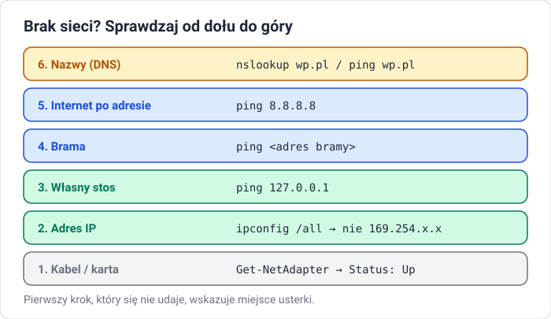

# Interfejs sieciowy i diagnostyka

!!! info "Cel lekcji"
    Po tej lekcji będziesz umieć odczytać konfigurację karty sieciowej, ustawić adres statyczny lub automatyczny w Windows, sprawdzić łączność narzędziami `ipconfig`, `ping`, `tracert` i `nslookup` oraz zlokalizować usterkę połączenia, sprawdzając warstwy od dołu do góry.

## Co musi mieć komputer, żeby działał w sieci

| Parametr | Do czego służy | Przykład |
|---|---|---|
| adres IP | identyfikuje komputer w sieci | `192.168.1.25` |
| maska podsieci | określa, które adresy są „w mojej sieci” | `255.255.255.0` |
| brama domyślna | router, przez który wychodzimy poza sieć lokalną | `192.168.1.1` |
| serwer DNS | zamienia nazwy (np. `wp.pl`) na adresy IP | `192.168.1.1` lub `8.8.8.8` |

Te dane komputer może dostać **automatycznie** z serwera DHCP (zwykle routera) albo mieć je wpisane **ręcznie** (adres statyczny).

## Gdzie to ustawić

### Sposób 1: Network Connections (działa w każdej wersji Windows)

1. ++win+r++ → `ncpa.cpl` → Enter.
2. Prawy przycisk na karcie (np. **Ethernet**) → **Properties (Właściwości)**.
3. Zaznacz **Internet Protocol Version 4 (TCP/IPv4)** → **Properties**.
4. Wybierz:
    - **Obtain an IP address automatically (Uzyskaj adres IP automatycznie)** — DHCP, albo
    - **Use the following IP address (Użyj następującego adresu IP)** — wpisz adres, maskę, bramę i serwer DNS.
5. **OK** → **Close**.

### Sposób 2: Settings (Ustawienia) w Windows 11

**Settings → Network & internet → Ethernet → IP assignment → Edit** → **Manual** → włącz **IPv4** → wpisz dane → **Save**.

### Sposób 3: PowerShell

```powershell
Get-NetAdapter                                   # nazwa karty i stan
New-NetIPAddress -InterfaceAlias "Ethernet" -IPAddress 192.168.1.25 `
    -PrefixLength 24 -DefaultGateway 192.168.1.1
Set-DnsClientServerAddress -InterfaceAlias "Ethernet" -ServerAddresses 8.8.8.8
```

Powrót do DHCP:

```powershell
Set-NetIPInterface -InterfaceAlias "Ethernet" -Dhcp Enabled
Set-DnsClientServerAddress -InterfaceAlias "Ethernet" -ResetServerAddresses
```

## Narzędzia diagnostyczne

| Polecenie | Co pokazuje |
|---|---|
| `ipconfig` | adres, maska, brama dla każdej karty |
| `ipconfig /all` | pełna konfiguracja: adres MAC, DHCP włączony/wyłączony, serwery DNS, dzierżawa |
| `ipconfig /release`, `ipconfig /renew` | zwolnij i pobierz ponownie adres z DHCP |
| `ipconfig /flushdns` | wyczyść pamięć podręczną DNS |
| `ping adres` | czy adres odpowiada i ile trwa podróż pakietu |
| `tracert adres` | przez które routery przechodzą pakiety |
| `nslookup nazwa` | jaki adres IP ma nazwa i który serwer DNS odpowiedział |
| `Test-NetConnection adres -Port 443` | czy dany port na serwerze jest osiągalny |

Przykładowy wynik `ipconfig`:

```text
Ethernet adapter Ethernet:

   Connection-specific DNS Suffix  . :
   IPv4 Address. . . . . . . . . . . : 192.168.1.25
   Subnet Mask . . . . . . . . . . . : 255.255.255.0
   Default Gateway . . . . . . . . . : 192.168.1.1
```

## Diagnozowanie usterki krok po kroku



Zaczynasz od najniższej warstwy. **Pierwszy krok, który się nie udaje, wskazuje miejsce usterki.**

| Objaw | Najczęstsza przyczyna | Co zrobić |
|---|---|---|
| karta `Disconnected` / `Media disconnected` | odłączony kabel, w VirtualBox odznaczone *Cable Connected* | podłącz kabel, sprawdź ustawienia VM |
| adres `169.254.x.x` | komputer nie dostał odpowiedzi z DHCP | `ipconfig /renew`, sprawdź router / sieć |
| `ping` do bramy nie działa, adres poprawny | zła maska lub brama z innej sieci | popraw konfigurację IPv4 |
| `ping 8.8.8.8` działa, `ping wp.pl` nie | błędny lub brak serwera DNS | wpisz poprawny DNS, `ipconfig /flushdns` |
| komunikat o konflikcie adresów | dwa urządzenia z tym samym IP | zmień adres statyczny lub przejdź na DHCP |

Windows ma też wbudowane narzędzie: prawy przycisk na ikonie sieci → **Troubleshoot problems (Rozwiąż problemy)**. Dobre na start, ale administrator powinien umieć znaleźć usterkę sam.

## Zadania

??? question "Zadanie 1: Odczytaj konfigurację"
    Na maszynie wirtualnej wykonaj `ipconfig /all`. Zapisz: adres IP, maskę, bramę, serwer DNS, adres MAC karty i informację, czy adres pochodzi z DHCP.

??? question "Zadanie 2: Adres statyczny i powrót"
    Ustaw na karcie adres statyczny zgodny z siecią, w której pracuje maszyna (np. dla NAT w VirtualBox: `10.0.2.50/24`, brama `10.0.2.2`, DNS `10.0.2.3`). Sprawdź dostęp do internetu. Następnie wróć do ustawień automatycznych. Udokumentuj oba ustawienia zrzutami ekranu.

??? question "Zadanie 3: Trzy sposoby"
    Wykonaj zmianę z zadania 2 kolejno w `ncpa.cpl`, w aplikacji Settings i w PowerShell. Który sposób był najszybszy, a który najłatwiej powtórzyć na 20 komputerach?

??? question "Zadanie 4: Popsuj i napraw"
    Wprowadź po kolei trzy usterki: błędna brama, błędny serwer DNS (`1.2.3.4`), wyłączona karta sieciowa. Dla każdej zapisz objaw (co działa, co nie) i polecenie, które pozwoliło ją wykryć. Usuń usterki.

??? question "Zadanie 5: Droga pakietu"
    Wykonaj `tracert 8.8.8.8`. Ile routerów jest po drodze? Który z nich to Twoja brama domyślna?
