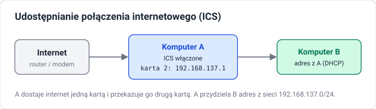

# Udostępnianie internetu

!!! info "Cel lekcji"
    Po tej lekcji będziesz umieć wyjaśnić, jak działa udostępnianie połączenia internetowego w Windows, skonfigurować je między dwiema maszynami wirtualnymi oraz uruchomić hotspot mobilny.

## Problem

W sali jest jeden komputer z dostępem do internetu (np. przez modem LTE) i drugi, który internetu nie ma, ale da się go połączyć z pierwszym kablem lub siecią Wi-Fi. Zamiast kupować router, można zamienić pierwszy komputer w mały router.

## Jak działa ICS

**Internet Connection Sharing (ICS, Udostępnianie połączenia internetowego)** to funkcja Windows, w której komputer:

- ma **dwie karty sieciowe**: jedną z dostępem do internetu, drugą połączoną z siecią lokalną,
- dostaje adres `192.168.137.1` na karcie lokalnej,
- **sam przydziela adresy** innym komputerom z sieci `192.168.137.0/24` (działa jak mały serwer DHCP),
- **przekazuje ruch** do internetu i z powrotem (tłumaczenie adresów, NAT).

## Konfiguracja ICS

Na komputerze A (tym z internetem):

1. ++win+r++ → `ncpa.cpl`.
2. Prawy przycisk na karcie **z internetem** → **Properties** → karta **Sharing (Udostępnianie)**.
3. Zaznacz **Allow other network users to connect through this computer's Internet connection (Zezwalaj innym użytkownikom sieci na łączenie się poprzez połączenie internetowe tego komputera)**.
4. W polu **Home networking connection** wybierz kartę połączoną z komputerem B.
5. **OK**. System uprzedzi, że karta lokalna dostanie adres `192.168.137.1`.

Na komputerze B ustaw kartę na **Obtain an IP address automatically** i wykonaj `ipconfig /renew`. Powinien dostać adres z sieci `192.168.137.x`, a jako bramę — `192.168.137.1`.

!!! warning "Karta Sharing nie jest widoczna?"
    Zakładka **Sharing** pojawia się tylko wtedy, gdy komputer ma co najmniej dwie karty sieciowe. W VirtualBox dodaj maszynie A drugą kartę (Adapter 2, *Internal Network*).

### Środowisko laboratoryjne w VirtualBox

| Maszyna | Adapter 1 | Adapter 2 |
|---|---|---|
| A (udostępnia) | NAT — internet | Internal Network `ics` |
| B (korzysta) | Internal Network `ics` | — |

## Hotspot mobilny

Windows 10/11 może też udostępnić internet przez Wi-Fi: **Settings → Network & internet → Mobile hotspot (Hotspot mobilny)**. Wybierasz połączenie, które udostępniasz, ustawiasz nazwę sieci i hasło, a potem włączasz przełącznik. Wymaga karty Wi-Fi — w maszynie wirtualnej zwykle nie zadziała.

Ten sam mechanizm działa w telefonie: **Ustawienia → Hotspot osobisty / Tethering**.

## Zadania

??? question "Zadanie 1: Zbuduj lab"
    Przygotuj dwie maszyny wirtualne z kartami sieciowymi według tabeli z lekcji. Zrób zrzuty ekranu ustawień sieci obu maszyn w VirtualBox.

??? question "Zadanie 2: Włącz ICS"
    Włącz udostępnianie połączenia na maszynie A. Pokaż wynik `ipconfig` na obu maszynach i udany `ping 8.8.8.8` z maszyny B.

??? question "Zadanie 3: Prześledź ruch"
    Na maszynie B wykonaj `tracert 8.8.8.8`. Który adres jest pierwszym routerem na trasie i dlaczego właśnie ten?

??? question "Zadanie 4: Wyłącz i sprawdź"
    Wyłącz ICS na maszynie A, a na B wykonaj `ipconfig /release` i `ipconfig /renew`. Jaki adres dostała maszyna B i co to oznacza?

??? question "Zadanie 5: Kiedy ICS, a kiedy router"
    Podaj jedną sytuację, w której ICS jest rozsądnym rozwiązaniem, i jedną, w której lepszy będzie router. Uzasadnij.
