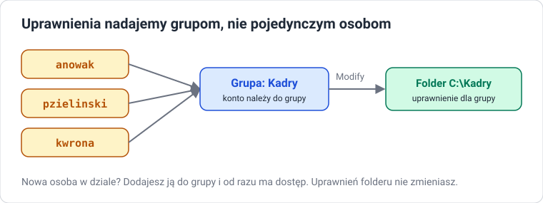

# Konta i grupy lokalne

!!! info "Cel lekcji"
    Po tej lekcji będziesz umieć rozróżnić rodzaje kont w Windows, wymienić najważniejsze grupy wbudowane, utworzyć, zmodyfikować, wyłączyć i usunąć konto oraz grupę — w GUI, poleceniem `net` i w PowerShell.

## Dlaczego każdy ma osobne konto

Gdy kilka osób korzysta z jednego komputera na jednym koncie, nie wiadomo, kto co zrobił, każdy widzi pliki innych, a jedno kliknięcie w złośliwy załącznik ma uprawnienia administratora. Osobne konta dają: **rozliczalność** (kto?), **prywatność** (czyje pliki?) i **najmniejsze uprawnienia** (tylko tyle, ile trzeba).

## Rodzaje kont

| Konto | Opis |
|---|---|
| **lokalne** | istnieje tylko na tym komputerze; dane logowania przechowuje system lokalnie |
| **Microsoft** | logowanie adresem e-mail, ustawienia synchronizowane przez internet |
| **domenowe** | zarządzane centralnie przez serwer (Active Directory) — temat klasy 3 |

Każde konto ma też **typ**:

| Typ | Co może |
|---|---|
| **Administrator** | wszystko: instalacja programów, zmiana ustawień systemu, zarządzanie innymi kontami |
| **Standard user (Użytkownik standardowy)** | praca na własnych plikach i programach; zmiany systemowe wymagają hasła administratora (okno UAC) |

### Konta wbudowane

- **Administrator** — wbudowane konto administratora, domyślnie **wyłączone**.
- **Guest (Gość)** — domyślnie wyłączone.
- **DefaultAccount**, **WDAGUtilityAccount** — konta systemowe, nie logujemy się na nie.

## Grupy



**Grupa** zbiera konta, którym nadajemy te same uprawnienia. Zasada administratora: **uprawnienia nadajemy grupom, a użytkowników dodajemy do grup**.

| Grupa wbudowana | Członkowie mogą |
|---|---|
| **Administrators (Administratorzy)** | wszystko |
| **Users (Użytkownicy)** | zwykłą pracę; każde nowe konto trafia tu domyślnie |
| **Guests (Goście)** | bardzo ograniczony dostęp |
| **Backup Operators (Operatorzy kopii zapasowych)** | wykonywać kopie i przywracać pliki niezależnie od uprawnień |
| **Remote Desktop Users (Użytkownicy pulpitu zdalnego)** | logować się zdalnie przez RDP |
| **Event Log Readers** | czytać dzienniki zdarzeń |

## Zarządzanie w GUI

### lusrmgr.msc — Local Users and Groups

++win+r++ → `lusrmgr.msc` (albo `compmgmt.msc` → **Local Users and Groups**).

**Nowe konto:** folder **Users** → prawy przycisk → **New User…** → nazwa, pełna nazwa, opis, hasło i opcje:

| Opcja | Znaczenie |
|---|---|
| **User must change password at next logon** | przy pierwszym logowaniu trzeba zmienić hasło |
| **User cannot change password** | użytkownik nie może sam zmienić hasła |
| **Password never expires** | hasło nie wygasa |
| **Account is disabled** | konto wyłączone — istnieje, ale nie można się zalogować |

**Nowa grupa:** folder **Groups** → prawy przycisk → **New Group…** → nazwa, opis → **Add…** członków.

**Członkostwo:** dwuklik na koncie → karta **Member Of** → **Add…**.

### Inne miejsca

- **Settings → Accounts → Other users** — szybkie dodanie konta i zmiana typu (Administrator / Standard).
- `netplwiz` — lista kont, reset hasła, zmiana typu konta.

## Zarządzanie poleceniem net

Polecenie `net` działa w `cmd` i w PowerShellu, na każdej wersji Windows.

```powershell
net user                                   # lista kont
net user jkowalski Haslo123! /add          # nowe konto z hasłem
net user jkowalski /fullname:"Jan Kowalski"
net user jkowalski /active:no              # wyłącz konto
net user jkowalski                         # szczegóły konta
net user jkowalski /delete                 # usuń konto

net localgroup                             # lista grup
net localgroup Kadry /add                  # nowa grupa
net localgroup Kadry jkowalski /add        # dodaj konto do grupy
net localgroup Administrators              # członkowie grupy
```

## Zarządzanie w PowerShell

```powershell
Get-LocalUser
$haslo = Read-Host -AsSecureString "Hasło"
New-LocalUser -Name "jkowalski" -FullName "Jan Kowalski" -Description "Kadry" -Password $haslo
Disable-LocalUser -Name "jkowalski"
Enable-LocalUser -Name "jkowalski"
Set-LocalUser -Name "jkowalski" -PasswordNeverExpires $true
Remove-LocalUser -Name "jkowalski"

Get-LocalGroup
New-LocalGroup -Name "Kadry" -Description "Dział kadr"
Add-LocalGroupMember -Group "Kadry" -Member "jkowalski"
Get-LocalGroupMember -Group "Administrators"
Remove-LocalGroupMember -Group "Kadry" -Member "jkowalski"
```

!!! warning "Nazwy grup zależą od języka systemu"
    W polskim Windows grupa nazywa się `Administratorzy`, w angielskim `Administrators`. Sprawdź nazwy poleceniem `Get-LocalGroup` przed użyciem w skrypcie.

## Zadania

??? question "Zadanie 1: Konta w GUI"
    W `lusrmgr.msc` utwórz konta `anowak` i `pzielinski` z pełnymi imionami i nazwiskami. Pierwsze konto musi zmienić hasło przy pierwszym logowaniu, drugie ma być wyłączone. Zaloguj się na `anowak` i sprawdź, co się stanie.

??? question "Zadanie 2: Grupa działu"
    Utwórz grupę `Kadry` z opisem „Dział kadr” i dodaj do niej oba konta. Pokaż członków grupy w GUI i poleceniem `net localgroup`.

??? question "Zadanie 3: To samo z wiersza poleceń"
    Za pomocą polecenia `net` utwórz konto `kwrona`, dodaj je do grupy `Kadry`, a potem wyłącz. Za pomocą PowerShell utwórz konto `tsowa` z opisem „Księgowość” i hasłem, które nie wygasa.

??? question "Zadanie 4: Administrator czy nie"
    Zaloguj się jako użytkownik standardowy i spróbuj: zmienić strefę czasową, zainstalować program, utworzyć nowe konto. Zapisz, co się udało, a co wymagało hasła administratora. Wyjaśnij zasadę najmniejszych uprawnień na tym przykładzie.

??? question "Zadanie 5: Kto jest administratorem"
    Wyświetl członków grupy administratorów na swojej maszynie trzema sposobami: w GUI, poleceniem `net` i w PowerShell. Dlaczego regularne sprawdzanie tej listy to jeden z podstawowych obowiązków administratora?
