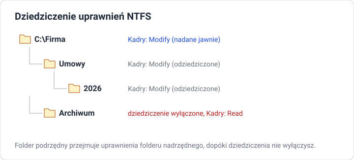

# Uprawnienia NTFS

!!! info "Cel lekcji"
    Po tej lekcji będziesz umieć odczytać i zmienić uprawnienia NTFS do pliku i folderu w interfejsie graficznym, rozróżnić uprawnienia standardowe, wyjaśnić działanie dziedziczenia i odmowy (Deny) oraz sprawdzić, jakie uprawnienia faktycznie ma użytkownik.

## Gdzie są uprawnienia

Prawy przycisk na pliku lub folderze → **Properties** → karta **Security (Zabezpieczenia)**.

- **Group or user names** — lista kont i grup, które mają wpis o uprawnieniach,
- **Permissions for …** — uprawnienia zaznaczonego konta: kolumny **Allow (Zezwalaj)** i **Deny (Odmów)**,
- **Edit…** — zmiana uprawnień,
- **Advanced** — dziedziczenie, właściciel, uprawnienia szczegółowe, uprawnienia efektywne.

Uprawnienia NTFS działają tylko na dyskach sformatowanych w **NTFS** (nie w FAT32 ani exFAT) — to jeden z powodów, dla których dysk systemowy Windows zawsze ma NTFS.

## Uprawnienia standardowe

| Uprawnienie | Folder: co pozwala zrobić | Plik: co pozwala zrobić |
|---|---|---|
| **Full control (Pełna kontrola)** | wszystko, także zmieniać uprawnienia i przejmować własność | wszystko |
| **Modify (Modyfikacja)** | czytać, zapisywać, tworzyć i **usuwać** | czytać, zmieniać, usuwać |
| **Read & execute (Odczyt i wykonanie)** | przeglądać zawartość, uruchamiać programy | czytać i uruchamiać |
| **List folder contents (Wyświetlanie zawartości folderu)** | widzieć nazwy plików i podfolderów | — |
| **Read (Odczyt)** | czytać pliki i ich atrybuty | czytać |
| **Write (Zapis)** | tworzyć pliki i podfoldery | zmieniać zawartość |

Każde uprawnienie standardowe to zestaw kilkunastu **uprawnień szczegółowych** (widocznych w **Advanced → Edit**). Na co dzień wystarczają standardowe.

!!! tip "Modify a Full control"
    Zwykłym użytkownikom dajemy najwyżej **Modify**. **Full control** pozwala dodatkowo zmieniać uprawnienia — użytkownik mógłby odebrać dostęp innym albo nadać go komuś niepowołanemu.

## Jak łączą się uprawnienia

Użytkownik może mieć uprawnienia z kilku źródeł: wpis dla jego konta i wpisy dla grup, do których należy.

- **Allow się sumują.** Konto `anowak` ma *Read*, a grupa `Kadry` (do której należy) ma *Modify* → `anowak` ma *Modify*.
- **Deny wygrywa z Allow** na tym samym poziomie. Jeśli którakolwiek grupa użytkownika ma *Deny* dla zapisu, zapisać nie może.
- **Uprawnienie nadane jawnie wygrywa z odziedziczonym.** Jawne *Allow* na folderze zadziała mimo odziedziczonego *Deny*.

!!! warning "Deny używaj oszczędnie"
    Odmowa dla grupy `Users` zablokuje też administratorów, bo każdy administrator jest zwykle także w `Users`. Zamiast Deny lepiej po prostu nie dawać uprawnienia.

## Dziedziczenie

Nowy plik lub folder **dziedziczy** uprawnienia folderu nadrzędnego. W oknie **Security** uprawnienia odziedziczone mają **wyszarzone pola wyboru** — nie da się ich zmienić w tym miejscu, tylko na folderze, z którego pochodzą.

**Wyłączenie dziedziczenia:** **Advanced → Disable inheritance**. System zapyta, co zrobić z dotychczasowymi uprawnieniami:

- **Convert inherited permissions into explicit permissions** — skopiuj je jako własne i edytuj (najczęstszy wybór),
- **Remove all inherited permissions from this object** — zacznij od zera (uwaga: możesz odciąć dostęp nawet sobie).

### Kopiowanie a przenoszenie

| Operacja | Co dzieje się z uprawnieniami |
|---|---|
| kopiowanie (dowolnie) | plik dostaje uprawnienia **folderu docelowego** |
| przenoszenie na **inny** wolumin | jak kopiowanie — uprawnienia folderu docelowego |
| przenoszenie w obrębie **tego samego** woluminu | plik **zachowuje** swoje dotychczasowe uprawnienia |

## Właściciel

Każdy plik i folder ma **właściciela** (**Advanced → Owner**) — zwykle konto, które go utworzyło. Właściciel zawsze może zmienić uprawnienia obiektu. Administrator może **przejąć własność** (**Change**), np. gdy pracownik odszedł, a jego folder jest niedostępny.

## Uprawnienia efektywne

**Advanced → Effective Access → Select a user** → **View effective access**. Windows pokaże, co dany użytkownik faktycznie może zrobić, po zsumowaniu wszystkich grup, Allow, Deny i dziedziczenia.

## Zadania

??? question "Zadanie 1: Odczyt uprawnień"
    Sprawdź uprawnienia do folderów `C:\Users`, `C:\Windows` i swojego folderu `C:\Users\<nazwa>`. Kto ma *Full control*, a kto tylko *Read & execute*? Które wpisy są odziedziczone?

??? question "Zadanie 2: Folder działu"
    Utwórz `C:\Firma\Kadry`. Nadaj grupie `Kadry` uprawnienie *Modify*, a grupie `Ksiegowosc` — *Read*. Zaloguj się kolejno na konto z każdej grupy i spróbuj: otworzyć plik, utworzyć plik, usunąć plik. Wyniki zapisz w tabeli.

??? question "Zadanie 3: Archiwum tylko do odczytu"
    W `C:\Firma\Kadry` utwórz podfolder `Archiwum`. Wyłącz w nim dziedziczenie (z konwersją) i zmień uprawnienie grupy `Kadry` na *Read*. Sprawdź działanie na koncie z grupy `Kadry`.

??? question "Zadanie 4: Allow i Deny"
    Konto `anowak` należy do grupy `Kadry` (*Modify*). Dodaj dla konta `anowak` jawne *Deny* dla *Write*. Co może teraz zrobić `anowak`? Potwierdź w **Effective Access**. Usuń wpis Deny.

??? question "Zadanie 5: Kopiowanie i przenoszenie"
    Utwórz plik w `C:\Firma\Kadry`. Skopiuj go do `C:\Firma\Publiczne`, a drugi plik przenieś tam z `C:\Firma\Kadry`. Porównaj uprawnienia obu plików w nowym miejscu i wyjaśnij różnicę.
