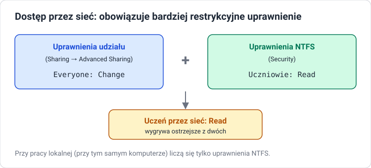

# Udostępnianie zasobów

!!! info "Cel lekcji"
    Po tej lekcji będziesz umieć udostępnić folder i drukarkę w sieci, ustawić uprawnienia udziału, wyznaczyć uprawnienia efektywne przy dostępie przez sieć, połączyć się z udziałem z innego komputera oraz zarządzać udziałami z wiersza poleceń.

## Udział sieciowy

**Udział (share)** to folder lub drukarka udostępnione innym komputerom w sieci. Klient łączy się z udziałem po ścieżce **UNC**:

```text
\\nazwa-komputera\nazwa-udziału        np. \\PC01\Dokumenty
\\adres-IP\nazwa-udziału               np. \\192.168.56.10\Dokumenty
```

Udostępnianie plików w Windows działa na protokole **SMB** (port TCP 445).

## Przygotowanie komputera

**Control Panel → Network and Sharing Center → Change advanced sharing settings** (Windows 11: **Settings → Network & internet → Advanced network settings → Advanced sharing settings**):

- **Network discovery** — włącz, żeby komputer był widoczny w sieci,
- **File and printer sharing** — włącz, żeby można było udostępniać zasoby.

Ustawienia są osobne dla profilu sieci **Private** i **Public**. W sieci laboratoryjnej ustaw profil **Private**.

## Udostępnienie folderu

1. Prawy przycisk na folderze → **Properties** → karta **Sharing (Udostępnianie)** → **Advanced Sharing… (Udostępnianie zaawansowane)**.
2. Zaznacz **Share this folder**, wpisz **Share name** (nazwa widoczna w sieci, może różnić się od nazwy folderu).
3. **Limit the number of simultaneous users** — ile osób naraz (w Windows 10/11 najwyżej 20).
4. **Permissions** — uprawnienia udziału:

| Uprawnienie udziału | Co pozwala przez sieć |
|---|---|
| **Read** | przeglądać i otwierać pliki |
| **Change** | także tworzyć, zmieniać i usuwać pliki |
| **Full Control** | także zmieniać uprawnienia |

Domyślnie udział ma **Everyone: Read**.

## Dwa zestawy uprawnień



Przy dostępie **przez sieć** działają **jednocześnie** uprawnienia udziału i uprawnienia NTFS. Windows liczy uprawnienie wynikowe z każdego zestawu osobno, a potem bierze **bardziej restrykcyjne** z dwóch.

| Udział | NTFS | Wynik przez sieć |
|---|---|---|
| Everyone: Change | Kadry: Modify | Kadry: **zmiana** |
| Everyone: Read | Kadry: Modify | Kadry: **odczyt** |
| Everyone: Change | Kadry: Read | Kadry: **odczyt** |
| Everyone: Full Control | Kadry: brak wpisu | Kadry: **brak dostępu** |

Przy pracy **lokalnej** (przy klawiaturze tego komputera) uprawnienia udziału nie mają znaczenia — liczy się tylko NTFS.

!!! tip "Praktyczna zasada"
    Uprawnienia udziału ustaw szeroko (np. **Everyone: Change** albo **Authenticated Users: Change**), a dokładną kontrolę zrób uprawnieniami NTFS. Wtedy zarządzasz dostępem w jednym miejscu.

## Połączenie z udziałem

Na drugim komputerze:

- **Eksplorator:** wpisz w pasku adresu `\\PC01\Dokumenty`,
- **mapowanie dysku:** **This PC → Map network drive** → litera (np. `Z:`) → ścieżka UNC,
- **wiersz poleceń:**

```powershell
net use Z: \\PC01\Dokumenty                  # zamapuj dysk Z:
net use Z: \\PC01\Dokumenty /user:PC01\anowak # jako inny użytkownik
net use                                      # lista połączeń
net use Z: /delete                           # odłącz
```

Logujesz się kontem istniejącym **na komputerze, który udostępnia** zasób (w grupie roboczej każdy komputer ma własne konta).

## Udziały ukryte i administracyjne

Udział, którego nazwa kończy się znakiem **`$`**, jest **ukryty** — nie widać go na liście zasobów komputera, ale można się z nim połączyć, znając pełną nazwę: `\\PC01\Raporty$`.

Windows tworzy automatycznie udziały administracyjne: `C$`, `D$` (całe dyski), `ADMIN$` (folder Windows), `IPC$`. Dostęp do nich mają tylko administratorzy.

## Zarządzanie z wiersza poleceń

```powershell
net share                                               # lista udziałów
net share Dokumenty=C:\Firma\Dokumenty /grant:Everyone,CHANGE
net share Raporty$=C:\Firma\Raporty /grant:Kadry,READ   # udział ukryty
net share Dokumenty /delete                             # zakończ udostępnianie

Get-SmbShare
New-SmbShare -Name Dokumenty -Path C:\Firma\Dokumenty -ChangeAccess Everyone
Get-SmbShareAccess -Name Dokumenty
Remove-SmbShare -Name Dokumenty
```

Kto jest teraz połączony: **Computer Management → Shared Folders → Sessions / Open Files** albo `Get-SmbSession`.

## Udostępnienie drukarki

**Settings → Bluetooth & devices → Printers & scanners** → drukarka → **Printer properties** → karta **Sharing** → **Share this printer** → nazwa udziału. Na kliencie: `\\PC01\nazwa-drukarki` lub **Add a printer**.

## Zadania

??? question "Zadanie 1: Środowisko"
    Przygotuj dwie maszyny wirtualne w tej samej sieci (np. *Internal Network* z adresami statycznymi `192.168.56.10` i `.20`). Włącz na pierwszej wykrywanie sieci i udostępnianie plików. Sprawdź łączność poleceniem `ping`.

??? question "Zadanie 2: Pierwszy udział"
    Udostępnij folder `C:\Firma\Dokumenty` jako `Dokumenty` z uprawnieniem udziału *Everyone: Read*. Połącz się z nim z drugiej maszyny i spróbuj utworzyć plik. Opisz wynik.

??? question "Zadanie 3: Uprawnienia efektywne"
    Dla udziału z zadania 2 ustaw kolejno kombinacje z tabeli w lekcji. Dla każdej sprawdź z drugiej maszyny, co może zrobić konto `anowak` (członek grupy `Kadry`). Wyniki zapisz w tabeli.

??? question "Zadanie 4: Udział ukryty i mapowanie"
    Udostępnij `C:\Firma\Raporty` jako udział ukryty `Raporty$` poleceniem `net share`. Sprawdź, że nie widać go w `\\PC01`, a następnie zamapuj go jako dysk `R:` poleceniem `net use`.

??? question "Zadanie 5: Kto jest połączony"
    Gdy druga maszyna ma otwarty plik z udziału, sprawdź na pierwszej, kto jest połączony i jaki plik jest otwarty — w Computer Management i w PowerShell.
