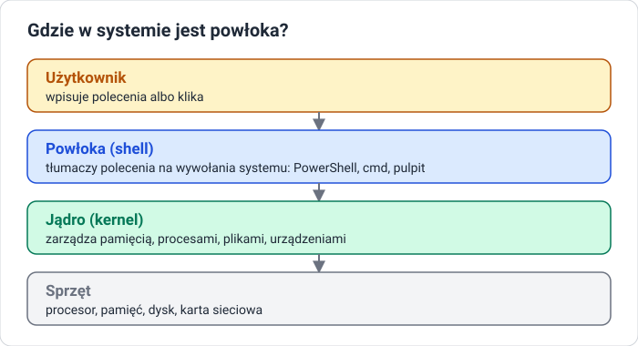
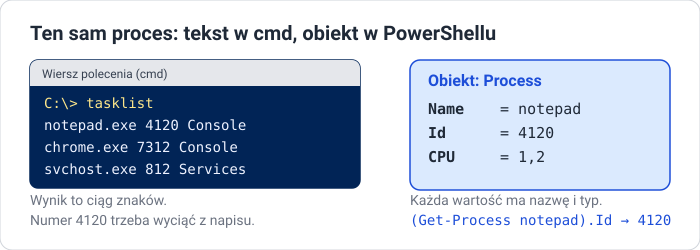
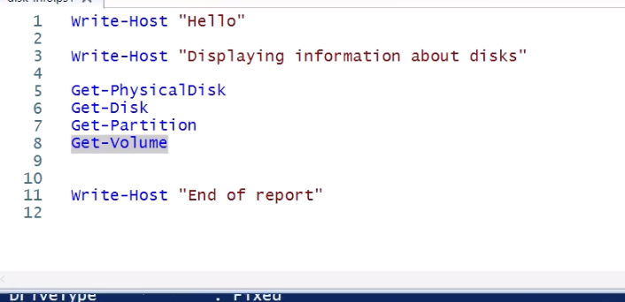

# Lekcja 1 — Czym jest powłoka

!!! info "Cel lekcji"
    Po tej lekcji będziesz umieć wyjaśnić, czym jest powłoka i czym różni się praca w GUI od pracy w wierszu poleceń, opisać najważniejsze etapy historii PowerShella, wyjaśnić różnicę między tekstem a obiektem, uruchomić PowerShell jako administrator i napisać pierwszy skrypt w ISE.

## Gdzie w systemie jest powłoka



**Powłoka (shell)** to program, który przyjmuje polecenia od człowieka i przekazuje je systemowi operacyjnemu. Powłoka nie jest częścią jądra — to zamienny program. Powłoką jest też graficzny pulpit: kliknięcie ikony to także polecenie dla systemu.

## Dwa sposoby rozmawiania z systemem

| GUI — interfejs graficzny | CLI — wiersz poleceń |
|---|---|
| okna, menu, przyciski | polecenia wpisywane tekstem |
| łatwy na start, widać opcje | wymaga znajomości nazw poleceń |
| każdą operację trzeba wyklikać ręcznie | polecenia można zapisać w pliku (skrypt) |
| trudno powtórzyć 100 razy tak samo | powtarzalne, szybkie, bez pomyłek |
| wolny przy dużej liczbie zadań | działa też zdalnie, bez grafiki |

**Przykład: trzy foldery.** W GUI to około 12 kliknięć: prawy przycisk → *New → Folder* → nazwa → Enter, trzy razy. W PowerShellu jedna linijka:

```powershell
1..3 | ForEach-Object { New-Item -ItemType Directory -Name "Folder$_" }
```

Zmieniasz `3` na `100` i masz sto folderów w sekundę. Każdy element tej linijki poznasz w tym dziale.

## Rodzaje powłok

| | cmd.exe | PowerShell |
|---|---|---|
| Czym jest | klasyczny wiersz poleceń Windows | nowoczesna powłoka Microsoftu |
| Polecenia | proste: `dir`, `copy`, `ipconfig` | cmdlety i potok obiektów |
| Wynik | zwykły tekst | obiekty |
| Skrypty | pliki `.bat` | pliki `.ps1` |

Każdy system ma swoją powłokę (Linux najczęściej `bash`), ale idea jest wspólna: polecenia i skrypty.

## Po co administratorowi wiersz poleceń

- **Automatyzacja** — zadanie wykonane raz zapisujemy i uruchamiamy, ile razy trzeba.
- **Powtarzalność** — skrypt założy 50 kont tak samo, człowiek się pomyli.
- **Szybkość** — jedna linijka zastępuje dziesięć kliknięć w kilku oknach.
- **Zdalna praca** — serwerem można zarządzać bez pulpitu, przez sieć.
- **Dostęp do wszystkiego** — ustawienia, których GUI nie pokazuje, są dostępne z konsoli.

Klasyczny `cmd` ma ograniczenia: wynik to tekst, język skryptów `.bat` jest ubogi, żeby wyciągnąć jedną liczbę, trzeba ciąć napisy, a każde narzędzie ma własne przełączniki i format.

## Skąd wziął się PowerShell

| Rok | Wydarzenie |
|---|---|
| 1993 | `cmd.exe` w Windows NT — tekstowa powłoka |
| 2002 | Jeffrey Snover pisze *Monad Manifesto*: powłoka oparta na obiektach |
| 2006 | PowerShell 1.0 |
| 2009 | PowerShell 2.0 — zdalne wykonywanie poleceń, w Windows 7 i Server 2008 R2 |
| 2016 | otwarty kod, wersje dla Linuksa i macOS; Windows PowerShell 5.1 |
| 2018 | PowerShell Core 6 — oparty na .NET Core |
| 2020 | PowerShell 7 — jedna linia dla wszystkich systemów |

### Dwie wersje

| Windows PowerShell 5.1 | PowerShell 7 |
|---|---|
| program `powershell.exe` | program `pwsh.exe` |
| wbudowany w Windows i Windows Server | instalowany osobno |
| oparty na .NET Framework | oparty na nowoczesnym .NET |
| tylko Windows | Windows, Linux, macOS |
| **tego używamy na zajęciach** | te same podstawy, nowsze możliwości |

Wersję sprawdzisz zmienną `$PSVersionTable`:

```text
PS C:\> $PSVersionTable

Name                           Value
----                           -----
PSVersion                      5.1.20348.2227
PSEdition                      Desktop
```

`PSVersion 5.1` i `Desktop` to Windows PowerShell. `PSVersion 7` i `Core` to PowerShell 7.

## Najważniejsza idea: tekst kontra obiekty



```text
C:\> tasklist | findstr notepad
notepad.exe   4120 Console   1   31 244 K
```

W `cmd` numer procesu to druga kolumna tekstu — trzeba go wyciąć z napisu.

```powershell
PS> (Get-Process notepad).Id
4120
```

W PowerShellu `Id` to właściwość obiektu. Wynik to czysta liczba, nic nie trzeba wycinać.

### Co to jest obiekt

**Obiekt = cechy + czynności.**

- **Właściwości (Properties)** — cechy, które można odczytać: `Process.Name`, `Process.Id`, `Process.CPU`.
- **Metody (Methods)** — czynności, które obiekt potrafi wykonać: `Process.Kill()`, `Process.Refresh()`.

PowerShell jest zbudowany na platformie **.NET**: wszystko jest obiektem pewnego typu. Typy podstawowe to np. `[int]` (liczba całkowita), `[string]` (napis), `[bool]` (prawda/fałsz), `[datetime]` (data). Typy złożone to proces, usługa, plik, folder, użytkownik.

**Przykład: obiekt daty.**

```powershell
PS> $d = Get-Date
PS> $d.Year          # właściwość: odczytujemy cechę
2026
PS> $d.DayOfWeek     # właściwość
Sunday
PS> $d.AddDays(7)    # metoda: obiekt coś robi i zwraca nową datę
```

Metoda ma nawiasy, właściwość nie.

## Uruchamianie PowerShella

- **Start** → wpisz `PowerShell` → **Windows PowerShell**
- **Win + X** → **Windows PowerShell (Admin)**
- **Win + R** → `powershell` → Enter
- jako administrator: prawy przycisk → **Run as administrator**

!!! warning "Okno administratora"
    Bez praw administratora wiele poleceń zgłosi błąd dostępu. Okno administratora ma w tytule słowo **Administrator:**.

### Gdzie pracujemy

| Konsola | Windows Terminal | ISE |
|---|---|---|
| okno `powershell.exe`, dostępne w każdym Windows | nowsza aplikacja z kartami, domyślna w Windows 11 | *Integrated Scripting Environment* — edytor skryptu z konsolą |
| do pojedynczych poleceń | na Server 2022 zwykle trzeba ją doinstalować | kolorowanie składni, **F5** uruchamia skrypt, **F8** zaznaczony fragment |

### Jak czytać znak zachęty

```text
PS C:\Users\Administrator> Get-Date
```

`PS` — to PowerShell, nie cmd. `C:\Users\Administrator` — bieżący folder. `>` — gotowy do przyjęcia polecenia.

### Przydatne na start

- **Kopiowanie w klasycznej konsoli:** zaznacz myszą i naciśnij Enter; wklejasz prawym przyciskiem myszy.
- **`Show-Command Get-Process`** — okno z formularzem parametrów polecenia.
- **`Start-Transcript .\hist.txt`** … **`Stop-Transcript`** — zapisuje wszystko, co wpisujesz i widzisz. Plik otworzysz poleceniem `notepad.exe .\hist.txt`.

## Pierwsze polecenia

```powershell
Get-Date
$PSVersionTable
Get-Location
Clear-Host
Write-Output "Witaj w PowerShellu"
Write-Host "Witaj z Write-Host"
Get-Servie
```

Ostatnia linia to celowa literówka. Przeczytaj komunikat błędu — czerwony tekst mówi, co i w którym miejscu się nie udało.

## Pierwszy skrypt w ISE



```powershell
Write-Host "Hello"

Write-Host "Displaying information about disks"

Get-PhysicalDisk
Get-Disk
Get-Partition
Get-Volume

Write-Host "End of report"
```

- `Write-Host` wypisuje tekst na ekran.
- Cztery polecenia pokazują informacje o dyskach: fizycznych, logicznych, partycjach i woluminach.
- Skrypt to zwykła lista poleceń wykonywana od góry do dołu.
- **F5** uruchamia cały skrypt, **F8** tylko zaznaczony fragment (na zrzucie: `Get-Volume`).

## Sprawdź się

??? question "1. Powłoka"
    Czym jest powłoka (shell) i gdzie znajduje się między użytkownikiem a systemem?

??? question "2. CLI kontra GUI"
    Podaj dwie zalety wiersza poleceń w porównaniu z klikaniem w GUI.

??? question "3. Tekst i obiekty"
    Jaka jest najważniejsza różnica między wynikiem polecenia w cmd a w PowerShellu?

??? question "4. Właściwość i metoda"
    Czym różni się właściwość obiektu od jego metody? Podaj przykład na obiekcie daty.

??? question "5. Wersja"
    Jak sprawdzisz, czy pracujesz w Windows PowerShell 5.1, czy w PowerShell 7?

??? question "6. Własny skrypt"
    Napisz w ISE skrypt `info.ps1`, który wypisuje powitanie, a potem pokazuje datę, wersję PowerShella i bieżący folder. Zapisz go w `C:\PS_Lab` i uruchom klawiszem F5.
