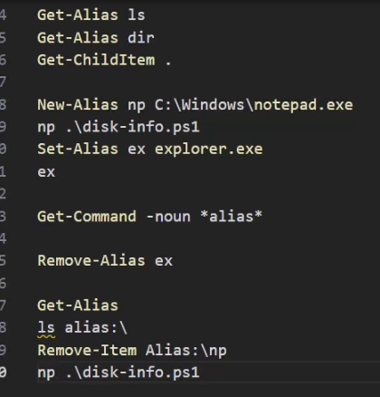

# Lekcja 2 — Pomoc, pliki, aliasy, parametry

!!! info "Cel lekcji"
    Po tej lekcji będziesz umieć rozpoznać budowę cmdletu, znaleźć polecenie do zadania przez `Get-Command` i przeczytać jego pomoc, wykonywać operacje na plikach i folderach, tworzyć i usuwać aliasy oraz podawać parametry na cztery sposoby — także kilka wartości naraz.

## Budowa polecenia


**Cmdlet** (wym. „komandlet”) to polecenie PowerShella w formie **Czasownik-Rzeczownik**. Nazwy są przewidywalne: `Get-Service` pokazuje usługi, `Stop-Service` je zatrzymuje.

| Czasownik | Znaczenie |
|---|---|
| `Get` | pobierz, pokaż informacje |
| `Set` | zmień istniejące ustawienie |
| `New` | utwórz nowy element |
| `Remove` | usuń element |
| `Add` | dodaj do istniejącego zbioru |
| `Start` / `Stop` | uruchom / zatrzymaj |
| `Enable` / `Disable` | włącz / wyłącz |
| `Test` | sprawdź, czy coś jest prawdą |

Pełną listę zatwierdzonych czasowników pokazuje `Get-Verb`.

## Pomoc: Get-Help

```powershell
Update-Help                          # pobiera pełną pomoc (administrator, internet) — raz po instalacji
Get-Help Get-Process                 # opis i składnia
Get-Help Get-Process -Examples       # same przykłady — zaczynaj od nich
Get-Help Get-Process -Full           # pełny opis każdego parametru
Get-Help Get-Process -ShowWindow     # okno z wyszukiwaniem (tylko 5.1)
Get-Help Get-Process -Online         # strona w przeglądarce
man Get-Process                      # skrót, wyświetla stronami
```

Polecenia są zebrane w **modułach**. `Get-Module -ListAvailable` pokaże dostępne moduły, a `Get-Command -Module nazwa` — polecenia jednego modułu.

## Odkrywanie poleceń: Get-Command

```powershell
Get-Command -Verb Get           # po czasowniku
Get-Command -Noun Service       # po rzeczowniku
Get-Command *process*           # z gwiazdką
```

```text
PS> Get-Command -Noun Service

CommandType  Name
-----------  ----
Cmdlet       Get-Service
Cmdlet       New-Service
Cmdlet       Restart-Service
Cmdlet       Set-Service
Cmdlet       Start-Service
Cmdlet       Stop-Service
```

Jedno słowo, a dostajesz komplet operacji.

!!! tip "Metoda, która działa zawsze"
    **Cel** (np. restart usługi drukowania) → **wyszukanie** (`Get-Command *service*`) → **pomoc** (`Get-Help Restart-Service -Examples`) → **wykonanie** (`Restart-Service -Name Spooler`). Nie musisz znać polecenia na pamięć.

## Pliki i foldery

Ta sama czynność ma trzy nazwy:

| cmd | Skrót w PowerShellu | Pełne polecenie |
|---|---|---|
| `dir` | `ls`, `dir` | `Get-ChildItem` |
| `mkdir` | `md`, `mkdir` | `New-Item -ItemType Directory` |
| `rmdir` | `rd`, `rmdir` | `Remove-Item` (`-Recurse` dla niepustego) |
| `copy` | `cp`, `copy` | `Copy-Item` |
| `move` | `mv`, `move` | `Move-Item` |
| `del` | `rm`, `del` | `Remove-Item` |
| `type` | `cat`, `type` | `Get-Content` |

### Rodzina Content: czytanie i zapis tekstu

Wzorzec `Get-`, `Set-`, `Add-`, `Clear-` powtarza się dla wielu rzeczy.

```powershell
New-Item data\report.txt
Set-Content data\report.txt -Value "Monday`nTuesday`nThursday"   # nadpisuje
Add-Content data\report.txt "Friday"                              # dopisuje
Get-Content data\report.txt                                       # czyta
Clear-Content data\report.txt                                     # czyści
```

Znak `` `n `` w cudzysłowie podwójnym oznacza nową linię.

## Aliasy

**Alias** to skrót do istniejącego polecenia.

| Alias | Pełne polecenie |
|---|---|
| `ls`, `dir`, `gci` | `Get-ChildItem` |
| `cd`, `sl` | `Set-Location` |
| `cls`, `clear` | `Clear-Host` |
| `cat`, `gc`, `type` | `Get-Content` |
| `ps`, `gps` | `Get-Process` |
| `?` | `Where-Object` |
| `%` | `ForEach-Object` |

```powershell
Get-Alias ls                          # ls -> Get-ChildItem
New-Alias np C:\Windows\notepad.exe   # tworzy alias
np                                    # otwiera Notatnik
Set-Alias ex explorer.exe             # tworzy lub nadpisuje alias
ls alias:\                            # wszystkie aliasy, jak lista plików
Remove-Item Alias:\np                 # usuwa alias (w 5.1)
```



Na zrzucie: `dir` i `ls` to ten sam `Get-ChildItem`; `np` otwiera Notatnik, `ex` Eksplorator; `Get-Command -noun *alias*` zbiera polecenia o aliasach; po usunięciu alias `np` przestaje działać. `Remove-Alias` jest tylko w PowerShell 7 — w 5.1 używasz `Remove-Item Alias:\nazwa`.

!!! warning "Aliasy w konsoli tak, w skryptach nie"
    W konsoli aliasy przyspieszają pracę. W skryptach używaj pełnych nazw — są czytelne dla każdego.

## Parametry

### Jak czytać składnię z pomocy

```text
PS> Get-Help Get-NetAdapter

SYNTAX
  Get-NetAdapter [[-Name] <String[]>]
                 [-IncludeHidden] [-Physical]
                 [<CommonParameters>]
```

- `[ ]` — parametr opcjonalny,
- `[-Name]` w podwójnym nawiasie — parametr pozycyjny, nazwę można pominąć,
- `<String[]>` — lista tekstów rozdzielonych przecinkami,
- `-Physical` — przełącznik, bez wartości.

### Cztery sposoby podawania parametrów

| Sposób | Przykład | Opis |
|---|---|---|
| nazwany | `Get-NetAdapter -Name *Ethernet*` | nazwa i wartość; kolejność parametrów nie ma znaczenia |
| pozycyjny | `Get-NetAdapter *Ethernet*` | wartość bez nazwy, w miejscu oznaczonym jako pozycja |
| przełącznik | `Get-NetAdapter -Physical` | włącza opcję, nie ma wartości |
| skrócony | `Get-NetAdapter -Ph` | wystarczy początek jednoznacznie wskazujący parametr |

### Wiele wartości: lista, zmienna, plik

```powershell
Get-ItemProperty -Path C:\Windows,C:\Users           # lista po przecinku

$foldery = "C:\Windows","C:\Users"                     # lista w zmiennej
Get-ItemProperty -Path $foldery

"C:\Windows","C:\Users" > C:\PS_Lab\foldery.txt        # lista w pliku
$zPliku = Get-Content C:\PS_Lab\foldery.txt
Get-ItemProperty $zPliku
```

Znak `>` zapisuje wynik do pliku. Zmienna zapamiętuje listę, a `Get-Content` wczytuje ją z pliku.

## Sprawdź się

??? question "1. Zgadnij polecenie"
    Bez komputera zapisz, jak najpewniej nazywa się polecenie, które: wyłącza konto lokalne, uruchamia usługę, tworzy nowego użytkownika lokalnego, sprawdza połączenie sieciowe. Potem sprawdź swoje przypuszczenia przez `Get-Command`.

??? question "2. Od celu do polecenia"
    Twoim celem jest wyświetlenie listy zainstalowanych aktualizacji. Opisz, jakimi poleceniami znajdziesz odpowiedni cmdlet i jego przykłady użycia, a następnie wykonaj tę drogę.

??? question "3. Czytanie składni"
    Wyświetl pomoc dla `Get-ChildItem`. Wskaż jeden parametr pozycyjny, jeden przełącznik i jeden parametr przyjmujący listę wartości.

??? question "4. Trzy nazwy jednej czynności"
    Skopiuj plik w `C:\PS_Lab` trzy razy: poleceniem z cmd, aliasem PowerShella i pełną nazwą cmdletu. Sprawdź, czy wszystkie trzy zadziałały tak samo.
