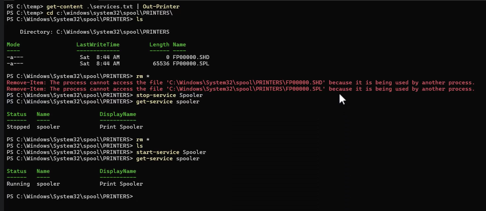

# Lekcja 3 — Bezpieczeństwo i potok

!!! info "Cel lekcji"
    Po tej lekcji będziesz umieć sprawdzić skutki polecenia przed jego wykonaniem, łączyć polecenia w potok, zbadać obiekt poleceniem `Get-Member`, sformatować wynik i skierować go na ekran, do okna lub do pliku oraz zarządzać procesami, usługami i zadaniami drukowania.

## -WhatIf i -Confirm

```text
PS> Remove-Item .\plik.txt -WhatIf
What if: Performing the operation "Remove File" on target "C:\PS_Lab\plik.txt".

PS> Remove-Item .\plik.txt -Confirm
Confirm
Are you sure you want to perform this action?
Performing the operation "Remove File" on target "C:\PS_Lab\plik.txt".
[Y] Yes  [A] Yes to All  [N] No  [L] No to All  [S] Suspend  [?] Help (default is "Y"):
```

- `-WhatIf` tylko opisuje, co by się stało — nic nie zmienia.
- `-Confirm` pyta o zgodę przed wykonaniem.
- Działają przy poleceniach, które coś zmieniają.

!!! warning "Zasada"
    Przed kasowaniem lub wyłączaniem zawsze najpierw `-WhatIf`.

### $ConfirmPreference — kiedy PowerShell pyta sam

Każde polecenie ma określony „wpływ” (niski, średni, wysoki). PowerShell pyta o potwierdzenie, gdy wpływ polecenia jest co najmniej taki jak wartość `$ConfirmPreference`. Ustawienie działa w bieżącej sesji.

| Wartość | Kiedy pyta o potwierdzenie |
|---|---|
| `None` | nigdy (samo z siebie) |
| `High` | tylko przy poleceniach o wysokim wpływie — **wartość domyślna** |
| `Medium` | przy poleceniach o średnim i wysokim wpływie, np. `Remove-Item` |
| `Low` | prawie zawsze, nawet przy niskim wpływie |

## Potok |


Znak `|` przekazuje **całe obiekty** z lewej strony do polecenia po prawej. Nic nie trzeba wycinać ani przepisywać.

Co widać po każdym ogniwie:

```text
PS> Get-Process
Name     Id    CPU
svchost   812    3,1
chrome   7312  412,3
notepad  4120    1,2
code     9020  188,7

PS> Get-Process | Sort-Object CPU -Descending
Name     Id    CPU
chrome   7312  412,3
code     9020  188,7
svchost   812    3,1
notepad  4120    1,2

PS> Get-Process | Sort-Object CPU -Descending | Select-Object -First 2
Name     Id    CPU
chrome   7312  412,3
code     9020  188,7
```

Za każdym razem przepływają obiekty. Zmienia się ich liczba i kolejność.

| cmd | PowerShell |
|---|---|
| <code>tasklist &#124; findstr notepad</code> | <code>Get-Process &#124; Where-Object Name -eq notepad</code> |
| `findstr` szuka napisu w tekście | `Where-Object` filtruje po właściwości `Name` |
| wynik nadal jest tekstem | wynik nadal jest obiektem — dalej można sortować, liczyć, zapisywać |

## Get-Member — obiekt pod lupą

```text
PS> Get-Process | Get-Member

   TypeName: System.Diagnostics.Process

Name         MemberType  Definition
----         ----------  ----------
Kill         Method      void Kill()
Refresh      Method      void Refresh()
Id           Property    int Id {get;}
ProcessName  Property    string ProcessName {get;}
WorkingSet   Property    int WorkingSet {get;}
```

| Pojęcie | Znaczenie |
|---|---|
| **Klasa** | szablon obiektu, np. klasa `Process` |
| **Typ** | nazwa klasy konkretnego obiektu — `Get-Member` pokazuje ją jako `TypeName` |
| **Właściwość** | cecha obiektu: `Name`, `Id`, `CPU` |
| **Metoda** | czynność obiektu: `Kill()`, `Refresh()` |

Znasz nazwy właściwości, więc możesz po nich filtrować i sortować.

## Formatowanie wyniku

```text
PS> Get-Service Spooler | Format-Table -AutoSize

Status  Name     DisplayName
------  ----     -----------
Running Spooler  Print Spooler

PS> Get-Service Spooler | Format-List *

Name        : Spooler
DisplayName : Print Spooler
Status      : Running
StartType   : Automatic
CanStop     : True
```

!!! warning "Format-* na końcu potoku"
    Po `Format-Table` czy `Format-List` nie ma już obiektów do dalszej obróbki, jest tylko układ do wyświetlenia. Formatowanie to zawsze ostatni krok.

## Dokąd trafia wynik

| Cel | Polecenie |
|---|---|
| ekran | domyślnie (`Out-Host`) |
| okno z tabelą do sortowania i filtrowania myszą | <code>Get-Service &#124; Out-GridView</code> (tylko w środowisku graficznym) |
| plik tekstowy | <code>Get-Service &#124; Out-File u.txt</code> albo `Get-Service > u.txt` |
| dopisanie do pliku | `Get-Service >> u.txt` |
| plik CSV (arkusz kalkulacyjny) | <code>Get-Service &#124; Export-Csv u.csv</code> |
| nigdzie | <code>&#124; Out-Null</code> — odrzuca wynik |

## Pliki i foldery w potoku

```powershell
Get-ChildItem C:\Windows | Where-Object PSIsContainer   # tylko foldery
Get-ChildItem C:\Windows -File                          # tylko pliki
Get-ChildItem C:\Windows -Directory                     # tylko foldery
```

Pliki i foldery to obiekty z jedną różnicą: właściwość `PSIsContainer` jest prawdą dla folderu.

## Procesy i usługi

| Cmdlet | Co robi |
|---|---|
| `Get-Process` | lista uruchomionych procesów |
| `Stop-Process` | zatrzymuje proces (`-Name` lub `-Id`) |
| `Get-Service` | lista usług i ich stan (`Running` / `Stopped`) |
| `Start-Service` / `Stop-Service` | uruchamia / zatrzymuje usługę |
| `Restart-Service` | zatrzymuje i uruchamia ponownie |
| `Set-Service` | zmienia sposób uruchamiania (`-StartupType`) |

!!! warning "Tylko na maszynie ćwiczeniowej"
    Zatrzymywanie usług i procesów wykonuj tylko na maszynie wirtualnej.

### Przykład z życia: zacięta kolejka drukowania



Zadania drukowania czekają jako pliki w folderze `C:\Windows\System32\spool\PRINTERS`. Usługa **Spooler** (bufor wydruku) trzyma te pliki otwarte, więc `rm *` kończy się błędem *being used by another process*. Dopiero po `Stop-Service Spooler` pliki da się usunąć, a po `Start-Service Spooler` drukowanie wraca do działania.

### Drukarki

```powershell
Get-Command *print*                              # polecenia związane z drukowaniem
Get-Printer                                      # zainstalowane drukarki
Get-Printer -Name LabPrinter                     # jedna drukarka
Get-Content .\a.txt | Out-Printer -Name LabPrinter   # wydruk tekstu
Get-PrintJob -PrinterName LabPrinter             # zadania w kolejce
```

## Sprawdź się

??? question "1. Nazwa cmdletu"
    Z jakich dwóch części składa się nazwa cmdletu? Co oznacza czasownik `Get`, a co `Set`?

??? question "2. Właściwości obiektu"
    Jak sprawdzić, jakie właściwości ma obiekt zwracany przez `Get-Process`?

??? question "3. Potok"
    Co robi znak `|` w PowerShellu i czym różni się od potoku w cmd?

??? question "4. Formatowanie"
    Dlaczego `Format-Table` stawiamy na końcu potoku?

??? question "5. Bezpieczne usuwanie"
    Masz usunąć z `C:\PS_Lab` wszystkie pliki `.log`. Zapisz kolejne polecenia, którymi najpierw sprawdzisz, co zostanie usunięte, a potem usuniesz pliki.
