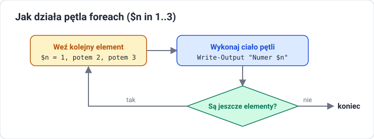

# Lekcja 4 — Dane i skrypty

!!! info "Cel lekcji"
    Po tej lekcji będziesz umieć sortować, liczyć, grupować i filtrować obiekty, tworzyć kolumny wyliczane, używać zmiennych i tablic, pisać instrukcje `if` i pętle, a następnie zbudować i uruchomić własny skrypt `.ps1` z uwzględnieniem Execution Policy.

## Cztery cmdlety do pracy z danymi

| Cmdlet | Co robi |
|---|---|
| `Sort-Object` | sortuje po właściwości; `-Descending` — malejąco |
| `Select-Object` | wybiera kolumny; `-First 5` / `-Last 5`; `-ExpandProperty` — samą wartość |
| `Measure-Object` | liczy elementy; suma, średnia, min, max |
| `Group-Object` | grupuje po właściwości i liczy elementy grup |

### Sort-Object

```text
PS> Get-Process | Sort-Object CPU -Descending | Select-Object -First 3 Name, CPU

Name          CPU
----          ---
MsMpEng     85,3
svchost     41,2
explorer    12,7
```

```powershell
Get-Process | Sort-Object Name, CPU        # kilka właściwości po przecinku
Get-Process | Get-Member | more            # more dzieli długi wynik na strony
```

W `more`: spacja — następna strona, Enter — następny wiersz, `q` — wyjście.

### Measure-Object i Group-Object

```text
PS> Get-Process | Measure-Object
Count    : 87

PS> Get-Process | Measure-Object WorkingSet -Sum -Average -Maximum
Count    : 87
Average  : 38520034
Sum      : 3351242000
Maximum  : 365629440
Property : WorkingSet

PS> Get-Service | Group-Object Status
Count Name     Group
----- ----     -----
   82 Running  {System.ServiceProcess...}
   94 Stopped  {System.ServiceProcess...}
```

### Select-Object i kolumny wyliczane

```text
PS> $mb = @{
>>   Name = 'MB'
>>   Expression = { [math]::Round($_.WorkingSet / 1MB, 1) }
>> }
PS> Get-Process | Select-Object -First 3 Name, $mb

Name       MB
----       --
conhost   6,3
csrss     4,9
dwm      38,2
```

- Kolumna wyliczana to para `Name` i `Expression`.
- `$_` oznacza bieżący obiekt z potoku.
- `1MB` to 1 048 576 bajtów — PowerShell zna jednostki `KB`, `MB`, `GB`.
- `[math]::Round(liczba, 1)` zaokrągla do jednego miejsca po przecinku.

## Where-Object — wybieranie obiektów

```powershell
Get-Service | Where-Object Status -eq "Running"      # wersja krótka
Get-Process | Where-Object { $_.CPU -gt 10 }         # wersja z blokiem
```

`$_` to bieżący obiekt przepływający przez potok, a `$_.CPU` to jego właściwość `CPU`.

W PowerShellu nie ma znaków `==`, `>` i `<` do porównań. Używamy operatorów z myślnikiem:

| Operator | Znaczenie |
|---|---|
| `-eq`, `-ne` | równe, różne |
| `-gt`, `-ge` | większe, większe lub równe |
| `-lt`, `-le` | mniejsze, mniejsze lub równe |
| `-like` | pasuje do wzorca z gwiazdką: `-like "win*"` |
| `-and`, `-or`, `-not` | i, lub, negacja |

**Składamy polecenie: trzy procesy z największą pamięcią.**

```powershell
Get-Process |                                 # pobierz wszystkie procesy
    Sort-Object WorkingSet -Descending |      # największa pamięć na górze
    Select-Object -First 3 Name, WorkingSet   # trzy pierwsze, dwie kolumny
```

## Zmienne

```powershell
$imie = "Anna"              # zmienna zaczyna się od $
$liczba = 5
[int] $wiek = 17            # typ można narzucić w nawiasach
[string] $tekst = "abc"
[datetime] $d = Get-Date
$uslugi = Get-Service       # zmienna może trzymać całą kolekcję obiektów
```

### Cudzysłów podwójny a pojedynczy

| Podwójny `" "` | Pojedynczy `' '` |
|---|---|
| podstawia wartości zmiennych | traktuje tekst dosłownie |
| `"Cześć $a"` → `Cześć Anna` | `'Cześć $a'` → `Cześć $a` |
| wyrażenie w `$( )`: `"Dziś $(Get-Date)"` | używaj, gdy nie chcesz podstawiania |

### Tablice

```text
PS> $osoby = "Anna", "Piotr", "Ola"
PS> $osoby[0]          # numer od początku, liczymy od zera
Anna
PS> $osoby[-1]         # numer od końca
Ola
PS> $osoby.Count
3
PS> 1..5               # zakres tworzy ciąg liczb
1  2  3  4  5
```

## Instrukcje sterujące

### if / elseif / else

```powershell
$liczba = 7

if ($liczba -gt 10) {
    Write-Output "Duża"
}
elseif ($liczba -gt 5) {
    Write-Output "Średnia"
}
else {
    Write-Output "Mała"
}
```

Dla 7: pierwszy warunek jest fałszywy, drugi prawdziwy. Wynik: `Średnia`.

### Pętle



```powershell
# foreach — dla każdego elementu kolekcji
foreach ($n in 1..3) {
    Write-Output "Numer $n"
}

# ForEach-Object — to samo w potoku
1..3 | ForEach-Object { $_ * 2 }

# while — dopóki warunek jest prawdziwy
$i = 0
while ($i -lt 3) { $i++ }
```

`foreach` działa na zmiennej, `ForEach-Object` — na obiektach z potoku.

## Budowanie skryptów

### Skrypt 1: rośnie krok po kroku

=== "Krok 1: wypisz"

    ```powershell
    Write-Output "Witaj"
    ```

=== "Krok 2: zmienna"

    ```powershell
    $imie = Read-Host "Imie"
    Write-Output "Witaj $imie"
    ```

=== "Krok 3: warunek"

    ```powershell
    $imie = Read-Host "Imie"
    if ($imie -eq "") {
        $imie = "nieznajomy"
    }
    Write-Output "Witaj $imie"
    ```

### Skrypt 2: wolne miejsce na dyskach

```powershell
# dyski.ps1
$dyski = Get-PSDrive -PSProvider FileSystem
foreach ($d in $dyski) {
    $wolne = [math]::Round($d.Free / 1GB, 1)
    Write-Output "Dysk $($d.Name): wolne $wolne GB"
    if ($wolne -lt 10) {
        Write-Warning "Malo miejsca na $($d.Name)"
    }
}
```

```text
PS> .\dyski.ps1
Dysk C: wolne 41,3 GB
Dysk D: wolne 7,8 GB
WARNING: Malo miejsca na D
```

- Wiersz 2: zmienna trzyma listę dysków (obiekty).
- Wiersz 3: pętla bierze dysk po dysku.
- Wiersz 4: `Free` to bajty — dzielimy przez `1GB` i zaokrąglamy.
- Wiersz 5: `$($d.Name)` wstawia właściwość obiektu do tekstu.
- Wiersze 6–8: ostrzeżenie, gdy zostało mniej niż 10 GB.

### Skrypt 3: bezpieczne sprzątanie starych plików

```powershell
# sprzatanie.ps1
$folder = "C:\PS_Lab\Temp"
$granica = (Get-Date).AddDays(-7)

Get-ChildItem $folder -File |
    Where-Object LastWriteTime -lt $granica |
    Remove-Item -WhatIf
```

- `$granica` to data sprzed 7 dni (metoda `AddDays`).
- Potok zapisany w trzech liniach dla czytelności — linia kończy się znakiem `|`.
- `Where-Object` zostawia pliki starsze niż granica.
- `-WhatIf` tylko pokazuje, co zostałoby usunięte. Pliki znikną dopiero po usunięciu tego parametru.

### Skrypt 4: pilnowanie usługi

```powershell
# pilnuj.ps1
$nazwa = "Spooler"
$usluga = Get-Service -Name $nazwa

if ($usluga.Status -eq "Running") {
    Write-Output "$nazwa dziala"
}
else {
    Write-Output "$nazwa stoi, uruchamiam"
    Start-Service -Name $nazwa
}
```

Zmieniasz jedną zmienną i pilnujesz dowolnej usługi.

## Cykl życia skryptu

1. **Napisz** — w Notatniku lub ISE.
2. **Zapisz** jako `.ps1` (w Notatniku: *Zapisz jako typ: Wszystkie pliki*, żeby nie powstał `skrypt.ps1.txt`).
3. **Sprawdź** Execution Policy — czy wolno uruchamiać skrypty.
4. **Uruchom**: `.\skrypt.ps1` — kropka i ukośnik oznaczają „z tego folderu”.
5. **Czytaj** wynik i błędy, popraw i uruchom ponownie.

### Execution Policy

| Polityka | Co wolno |
|---|---|
| `Restricted` | żadnych skryptów — domyślnie w Windows 10 i 11 |
| `AllSigned` | tylko podpisane |
| `RemoteSigned` | lokalne bez podpisu, z internetu tylko podpisane — domyślnie w Windows Server |
| `Unrestricted` | wszystko, z ostrzeżeniem |
| `Bypass` | bez blokad |

```powershell
Get-ExecutionPolicy
Set-ExecutionPolicy RemoteSigned -Scope CurrentUser
```

## Jak nie zepsuć sobie systemu

- **`-WhatIf`** — pokazuje, co polecenie by zrobiło, bez wykonania.
- **`-Confirm`** — pyta o potwierdzenie przed każdą operacją.
- **`Remove-Item`** usuwa bez kosza — najpierw sprawdź, co pokazuje `Get-ChildItem`.
- **Uprawnienia** — zmiany w systemie wymagają okna administratora.
- **Środowisko testowe** — nowe skrypty uruchamiaj najpierw na maszynie ćwiczeniowej.

## Skróty klawiszowe

| Klawisz / sytuacja | Efekt |
|---|---|
| ++tab++ | dopełnia polecenia i parametry |
| strzałka w górę / w dół | przegląda historię poleceń |
| ++f7++ lub `Get-History` | lista historii |
| ++ctrl+c++ | przerywa działające polecenie |
| czerwony tekst | błąd: przeczytaj, co i w którym miejscu się nie udało |

## Sprawdź się

??? question "1. $_"
    Co oznacza `$_` w poleceniu `Where-Object { $_.CPU -gt 10 }`?

??? question "2. Cudzysłowy"
    Jaka jest różnica między `"Cześć $a"` a `'Cześć $a'`?

??? question "3. Uruchamianie skryptu"
    Jak uruchomić skrypt `skrypt.ps1` z bieżącego folderu i po co jest kropka z ukośnikiem?

??? question "4. -WhatIf"
    Do czego służy parametr `-WhatIf` i kiedy warto go użyć?

??? question "5. Modyfikacja skryptu"
    Zmień skrypt `dyski.ps1` tak, aby oprócz wolnego miejsca wypisywał też procent zajętości dysku. Wskazówka: `Used` i `Free` to właściwości tego samego obiektu.
