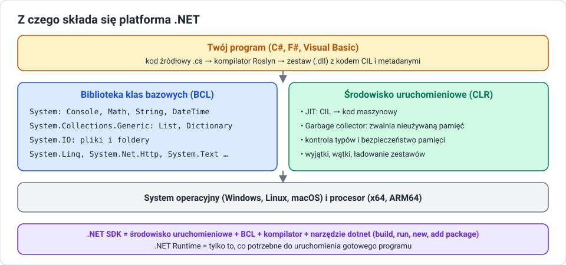

# Platforma .NET

!!! info "Cel lekcji"
    Po tej lekcji będziesz umieć wyjaśnić, czym jest platforma .NET i czym różni się od języka C#, wymienić jej główne składniki (CLR, BCL, SDK, Runtime), rozróżnić .NET Framework, .NET Core i współczesny .NET oraz odczytać, której wersji .NET używa Twój komputer i projekt.

## Język a platforma

**C#** to język — zestaw reguł zapisu programu. **.NET** to platforma — wszystko, czego program potrzebuje, żeby powstać i działać:

- narzędzia, które zamieniają kod na program (kompilator, narzędzie `dotnet`),
- środowisko, które ten program uruchamia i pilnuje jego działania,
- ogromna biblioteka gotowych klas: konsola, pliki, kolekcje, sieć, daty, matematyka, tekst.

Na .NET działają też inne języki: **F#** (funkcyjny) i **Visual Basic .NET**. Wszystkie kompilują się do tego samego kodu pośredniego, więc klasa napisana w F# może zostać użyta w programie w C#.



## Składniki platformy

### CLR — środowisko uruchomieniowe

**CLR (Common Language Runtime)** to „silnik”, który uruchamia program. Odpowiada za:

| Zadanie | Na czym polega |
|---|---|
| kompilacja JIT | zamienia kod pośredni CIL na instrukcje procesora w trakcie działania |
| zarządzanie pamięcią | przydziela pamięć dla nowych obiektów i zwalnia ją przez **garbage collector** |
| bezpieczeństwo typów | nie pozwala potraktować obiektu jako innego typu ani wyjść poza tablicę |
| obsługa wyjątków | przerywa program w kontrolowany sposób i pokazuje, co i gdzie się stało |
| wątki | pozwala wykonywać kilka zadań jednocześnie |

### BCL — biblioteka klas bazowych

**BCL (Base Class Library)** to tysiące gotowych typów pogrupowanych w **przestrzenie nazw**:

| Przestrzeń nazw | Co zawiera | Przykłady |
|---|---|---|
| `System` | typy podstawowe, konsola, matematyka, daty | `Console`, `Math`, `String`, `DateTime`, `Random` |
| `System.Collections.Generic` | kolekcje | `List<T>`, `Dictionary<K,V>`, `Queue<T>`, `Stack<T>` |
| `System.IO` | pliki i foldery | `File`, `Directory`, `StreamReader` |
| `System.Linq` | zapytania do kolekcji | `Where`, `OrderBy`, `Sum` |
| `System.Text` | praca z tekstem | `StringBuilder`, kodowanie znaków |
| `System.Net.Http` | komunikacja przez internet | `HttpClient` |

Zanim napiszesz coś od zera, sprawdź, czy nie ma tego w BCL. Sortowanie, zaokrąglanie, losowanie, odczyt pliku — wszystko to już jest.

### Wspólny system typów

**CTS (Common Type System)** opisuje typy wspólne dla wszystkich języków .NET. Słowa kluczowe C# to skróty nazw typów z biblioteki:

| C# | Typ .NET |
|---|---|
| `int` | `System.Int32` |
| `long` | `System.Int64` |
| `double` | `System.Double` |
| `bool` | `System.Boolean` |
| `char` | `System.Char` |
| `string` | `System.String` |
| `object` | `System.Object` |

`int x` i `System.Int32 x` to dokładnie to samo.

### SDK i Runtime

| | **.NET SDK** | **.NET Runtime** |
|---|---|---|
| dla kogo | programista | użytkownik programu |
| zawiera | Runtime + kompilator + narzędzie `dotnet` + szablony projektów | tylko CLR i bibliotekę |
| pozwala | tworzyć, budować, uruchamiać i publikować programy | uruchamiać gotowe programy |

Na komputerze programisty instalujemy **SDK**. Na komputerze, na którym program ma tylko działać, wystarczy **Runtime** — albo nic, jeśli program opublikujemy razem ze środowiskiem.

## Trzy pokolenia .NET

| | **.NET Framework** | **.NET Core** | **.NET (5 i nowsze)** |
|---|---|---|---|
| lata | 2002–2019 (ostatnia wersja 4.8.1) | 2016–2019 (wersje 1.0–3.1) | od 2020 |
| systemy | tylko Windows | Windows, Linux, macOS | Windows, Linux, macOS |
| kod | zamknięty | otwarty | otwarty |
| status | utrzymywany, bez nowych funkcji | zakończony | **rozwijany — tego używamy** |

Wersja 4 została pominięta przy zmianie nazwy z .NET Core na .NET, żeby nie mylić jej z .NET Framework 4.x. Dlatego po .NET Core 3.1 przyszedł od razu **.NET 5**.

!!! warning "Nie myl .NET Framework z .NET"
    W starszych poradnikach zobaczysz projekty na .NET Framework 4.x, tworzone tylko w Visual Studio na Windows. Działają, ale nie przenoszą się na inne systemy i nie dostają nowych funkcji. Nowe projekty tworzymy na aktualnym .NET.

### Cykl wydań

Nowa wersja .NET ukazuje się **co roku w listopadzie**:

- wersje **parzyste** (6, 8, 10 …) to **LTS** (*Long Term Support*) — wsparcie przez 3 lata, wybierane do poważnych projektów,
- wersje **nieparzyste** (7, 9, 11 …) to **STS** (*Standard Term Support*) — krótsze wsparcie, nowości szybciej.

Na zajęciach używamy wersji **LTS**.

## Jakie .NET masz na komputerze

```bash
dotnet --version        # wersja SDK używana w bieżącym folderze
dotnet --list-sdks      # wszystkie zainstalowane SDK
dotnet --list-runtimes  # wszystkie zainstalowane środowiska uruchomieniowe
dotnet --info           # pełna informacja: system, architektura, ścieżki
```

Wersję, dla której zbudowany jest projekt, zapisuje plik `.csproj` w znaczniku `<TargetFramework>`, np. `net10.0`. Wrócimy do niego w lekcji o projekcie.

## NuGet — biblioteki spoza platformy

Gdy czegoś nie ma w BCL, korzysta się z pakietów **NuGet** — publicznego repozytorium bibliotek .NET (nuget.org). Pakiet dodaje się poleceniem:

```bash
dotnet add package Spectre.Console
```

Informacja o pakiecie trafia do pliku `.csproj`, a przy budowaniu .NET sam go pobierze.

## Sprawdź się

??? question "1. Język i platforma"
    Wyjaśnij różnicę między C# a .NET na przykładzie: kto „rozumie” słowo `if`, a kto dostarcza klasę `Console`?

??? question "2. CLR"
    Wymień cztery zadania CLR. Które z nich sprawia, że w C# nie trzeba ręcznie zwalniać pamięci?

??? question "3. SDK czy Runtime"
    Kolega chce tylko uruchomić Twoją grę konsolową, a Ty chcesz ją dalej rozwijać. Co powinien zainstalować on, a co Ty? Uzasadnij.

??? question "4. Pokolenia"
    Projekt w poradniku ma w ustawieniach `net48`, a Twój `net10.0`. Na jakich platformach działają te projekty i który wybierzesz do nowego programu?

??? question "5. Twój komputer"
    Wykonaj `dotnet --list-sdks` i `dotnet --list-runtimes` (na komputerze w pracowni albo w Codespaces). Zapisz wyniki i wskaż, które wersje są LTS.

??? question "6. BCL"
    Korzystając z dokumentacji Microsoft Learn, znajdź klasę, która pozwala zmierzyć czas wykonania fragmentu programu, i klasę, która losuje liczby. Zapisz ich pełne nazwy razem z przestrzenią nazw.
