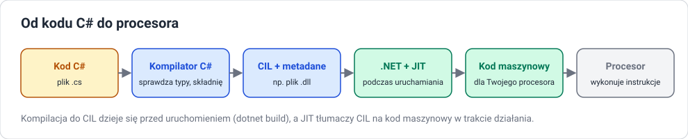

# Od kodu do uruchomionego programu

!!! info "Cel lekcji"
    Po tej lekcji będziesz umieć opisać etapy, przez które przechodzi program w C#: kompilację do kodu pośredniego CIL, powstanie zestawu (`.dll`), kompilację JIT podczas uruchamiania i pracę środowiska uruchomieniowego. Rozróżnisz też błędy kompilacji od błędów wykonania oraz kompilację JIT od kompilacji z góry (AOT).

## Kompilator i interpreter — przypomnienie pojęć

| | Kompilator | Interpreter |
|---|---|---|
| co robi | tłumaczy **cały** program na inną postać, zanim program zostanie uruchomiony | wykonuje program **na bieżąco**, instrukcja po instrukcji |
| kiedy wykrywa błędy składni i typów | przed uruchomieniem | dopiero gdy dojdzie do błędnej linii |
| wynik | plik do uruchomienia | brak osobnego pliku wynikowego |

W praktyce współczesne języki łączą oba podejścia. C# jest kompilowany **dwa razy**: najpierw do kodu pośredniego, potem — podczas działania — do kodu maszynowego.

## Droga programu C#



### Etap 1: kompilacja do CIL

Polecenie `dotnet build` uruchamia kompilator C# o nazwie **Roslyn**. Kompilator:

1. czyta wszystkie pliki `.cs` projektu,
2. sprawdza **składnię** (średniki, nawiasy, słowa kluczowe),
3. sprawdza **typy** (czy do `int` nie przypisujemy tekstu, czy metoda istnieje, czy ma tyle parametrów),
4. jeśli nie ma błędów — tworzy **kod pośredni CIL** (*Common Intermediate Language*, dawniej MSIL).

CIL to instrukcje dla wyimaginowanego procesora, niezależne od tego, czy program będzie działał na Intelu, AMD czy ARM. Fragment CIL dla `int c = a + b;` wygląda mniej więcej tak:

```text
ldloc.0      // połóż na stosie zmienną a
ldloc.1      // połóż na stosie zmienną b
add          // dodaj dwie wartości ze szczytu stosu
stloc.2      // zapisz wynik w zmiennej c
```

Nie piszemy w CIL ręcznie — to zadanie kompilatora.

### Etap 2: zestaw (assembly)

Wynikiem kompilacji jest **zestaw** (*assembly*) — plik `.dll` zawierający:

| Część | Co zawiera |
|---|---|
| **kod CIL** | wszystkie metody programu |
| **metadane** | opis typów: jakie są klasy, metody, parametry i ich typy |
| **manifest** | nazwa i wersja zestawu, lista zestawów, od których zależy |

Dzięki metadanym środowisko wie, co jest w zestawie, bez dodatkowych plików nagłówkowych. Dla aplikacji konsolowej powstaje też mały plik uruchamiający (`.exe` na Windows), który startuje .NET i ładuje `.dll`.

### Etap 3: uruchomienie i JIT

Gdy uruchamiasz program, **CLR**:

1. ładuje zestaw do pamięci,
2. sprawdza, czy kod CIL jest poprawny i bezpieczny,
3. przy **pierwszym** wywołaniu każdej metody kompilator **JIT** (*Just-In-Time*) zamienia jej CIL na kod maszynowy konkretnego procesora,
4. kolejne wywołania tej metody korzystają z gotowego kodu maszynowego.

JIT zna dokładnie procesor, na którym działa program, więc może użyć jego specjalnych instrukcji. Dlatego ten sam plik `.dll` działa na różnych komputerach i na każdym jest optymalizowany osobno.

### Etap 4: praca środowiska w tle

Przez cały czas działania programu CLR:

- przydziela pamięć na obiekty tworzone przez `new`,
- uruchamia **garbage collector**, który odnajduje obiekty, do których nie prowadzi już żadna zmienna, i zwalnia ich pamięć,
- zgłasza **wyjątki**, gdy dzieje się coś niedozwolonego (dzielenie liczby całkowitej przez zero, indeks poza tablicą, odwołanie przez `null`).

## Dwa rodzaje błędów

| | Błąd kompilacji | Błąd wykonania (wyjątek) |
|---|---|---|
| kiedy | podczas `dotnet build` | podczas działania programu |
| kto wykrywa | kompilator | środowisko uruchomieniowe (CLR) |
| skutek | program w ogóle nie powstaje | program przerywa działanie z komunikatem |
| przykład | `int x = "abc";` → `CS0029` | `int[] t = new int[3]; t[5] = 1;` → `IndexOutOfRangeException` |

Statyczne typowanie przesuwa jak najwięcej błędów do pierwszej kolumny — tam łatwiej je znaleźć i poprawić.

```text
Program.cs(3,9): error CS0029: Cannot implicitly convert type 'string' to 'int'
```

Komunikat kompilatora podaje: **plik**, **wiersz i kolumnę**, **numer błędu** i **opis**. Numer (np. `CS0029`) możesz wpisać w wyszukiwarkę, żeby znaleźć wyjaśnienie w dokumentacji.

## Debug i Release

| | Debug (domyślny) | Release |
|---|---|---|
| polecenie | `dotnet build` | `dotnet build -c Release` |
| optymalizacje | wyłączone | włączone |
| informacje dla debugera | pełne (plik `.pdb`) | ograniczone |
| zastosowanie | pisanie i szukanie błędów | wersja dla użytkowników |

## Publikowanie i kompilacja z góry

```bash
dotnet publish -c Release                                  # program wymagający zainstalowanego .NET
dotnet publish -c Release -r win-x64 --self-contained       # program razem ze środowiskiem .NET
```

Istnieje też kompilacja **Native AOT** (*Ahead-Of-Time*): cały program zamienia się na kod maszynowy już podczas publikacji, bez JIT. Program startuje szybciej i nie wymaga .NET, ale działa tylko na systemie i procesorze, dla którego go zbudowano. Na zajęciach używamy standardowego modelu z JIT.

## Kod zarządzany a niezarządzany

**Kod zarządzany** działa pod kontrolą CLR: ma automatyczne zarządzanie pamięcią, kontrolę typów i wyjątki. **Kod niezarządzany** (np. program w C skompilowany do kodu maszynowego) działa bezpośrednio na systemie — programista sam przydziela i zwalnia pamięć, a błąd może uszkodzić dane innych części programu bez żadnego komunikatu.

## Sprawdź się

??? question "1. Kolejność etapów"
    Ułóż w kolejności i opisz jednym zdaniem: JIT, plik `.cs`, procesor, Roslyn, zestaw `.dll`, CLR.

??? question "2. Po co kod pośredni"
    Dlaczego kompilator C# nie tworzy od razu kodu maszynowego? Podaj dwie zalety kodu pośredniego.

??? question "3. Rodzaj błędu"
    Dla każdego przykładu określ, czy to błąd kompilacji, czy wyjątek w czasie działania: brak średnika, dzielenie `10 / zero`, gdzie `zero` to zmienna `int` o wartości 0, wywołanie nieistniejącej metody, odczyt `t[10]` z tablicy 5-elementowej, przypisanie `double` do `int` bez rzutowania.

??? question "4. Co jest w zestawie"
    Wymień trzy części zestawu `.dll` i wyjaśnij, do czego CLR potrzebuje metadanych.

??? question "5. Debug czy Release"
    Zbuduj dowolny program w trybie Debug i Release. Porównaj zawartość folderów `bin/Debug` i `bin/Release`. Jakie pliki są w obu?
