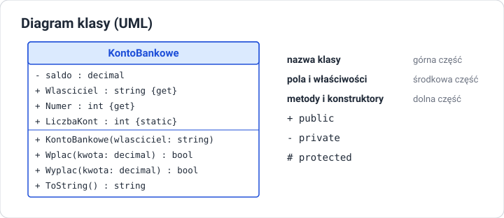

# Wprowadzenie do programowania obiektowego

!!! info "Cel lekcji"
    Po tej lekcji będziesz umieć wyjaśnić, czym programowanie obiektowe różni się od proceduralnego, opisać pojęcia klasy, obiektu, pola, metody i stanu obiektu, scharakteryzować cztery filary OOP (abstrakcję, hermetyzację, dziedziczenie, polimorfizm) oraz przełożyć opis problemu na projekt klasy i zapisać go jako diagram UML.

## Paradygmaty programowania

**Paradygmat** to sposób myślenia o tym, jak zbudować program.

| Paradygmat | Program to … | Przykład |
|---|---|---|
| **proceduralny** | ciąg instrukcji i procedur (metod) działających na danych przekazywanych z miejsca na miejsce | program liczący średnią ocen z tablicy |
| **obiektowy** | zbiór współpracujących **obiektów**, z których każdy ma własne dane i zachowanie | system bankowy z kontami, klientami i przelewami |
| **funkcyjny** | złożenie funkcji przekształcających dane bez zmieniania ich stanu | przetwarzanie danych zapytaniami LINQ |

C# wspiera wszystkie trzy, ale jego fundamentem jest programowanie obiektowe (*OOP — Object-Oriented Programming*).

## Problem: rozproszone dane

Wyobraź sobie grę z wieloma graczami, napisaną bez klas:

```csharp
string imie1 = "Ada";
int punkty1 = 10;
string imie2 = "Olek";
int punkty2 = 3;
// 100 graczy? 100 par zmiennych?
```

Albo z tablicami „równoległymi”:

```csharp
string[] imiona = { "Ada", "Olek", "Ewa" };
int[] punkty = { 10, 3, 7 };
int[] poziomy = { 2, 1, 1 };
// Sortujesz imiona — musisz pamiętać, żeby w tej samej kolejności posortować punkty i poziomy.
// Usuwasz gracza — z trzech tablic naraz.
```

Dane jednego gracza są rozrzucone po wielu zmiennych, a reguły (np. „punkty nie mogą być ujemne”) trzeba pilnować w każdym miejscu programu, które te dane zmienia. Przy rozbudowie programu łatwo o błąd.

## Rozwiązanie: obiekt

**Obiekt** łączy w jedną całość:

- **dane** — co obiekt wie o sobie (imię, punkty, poziom),
- **zachowanie** — co obiekt potrafi zrobić (dodać punkty, awansować, przedstawić się).

```csharp
class Gracz
{
    public string Imie = "";
    public int Punkty;
    public int Poziom = 1;

    public void DodajPunkty(int ile)
    {
        if (ile > 0) Punkty += ile;
        if (Punkty >= Poziom * 100) Poziom++;
    }
}
```

Teraz „gracz” to jeden byt. Lista graczy to `List<Gracz>`, a reguła dodawania punktów jest zapisana w jednym miejscu — w klasie.

## Klasa i obiekt

| | **Klasa** | **Obiekt** (instancja) |
|---|---|---|
| czym jest | **opis** rodzaju obiektów — wzór, plan, szablon | **konkretny egzemplarz** utworzony według tego opisu |
| ile ich jest | jedna definicja w kodzie | dowolnie wiele, każdy tworzony przez `new` |
| co zawiera | listę pól i metod | własne wartości pól |
| analogia | projekt domu | konkretne domy zbudowane według projektu |

```csharp
Gracz ada = new Gracz();    // pierwszy obiekt
Gracz olek = new Gracz();   // drugi obiekt — osobne Imie, Punkty, Poziom
ada.Imie = "Ada";
olek.Imie = "Olek";
ada.DodajPunkty(150);       // zmienia tylko obiekt ada
```

Pojęcia:

- **pole** — zmienna należąca do obiektu,
- **metoda** — działanie, które obiekt wykonuje; ma dostęp do pól swojego obiektu,
- **stan obiektu** — aktualne wartości wszystkich jego pól,
- **składowe** (*members*) — wspólna nazwa pól, właściwości, metod i konstruktorów.

Każda klasa jest nowym **typem** — tak jak `int` czy `string`. Można tworzyć zmienne typu `Gracz`, tablice `Gracz[]`, listy `List<Gracz>` i przekazywać obiekty do metod.

## Cztery filary programowania obiektowego

| Filar | Pytanie | W skrócie |
|---|---|---|
| **Abstrakcja** | Co jest istotne w modelu? | opisujemy obiekt tylko przez to, co ważne dla zadania |
| **Hermetyzacja** (enkapsulacja) | Kto może zmieniać dane obiektu? | ukrywamy dane i udostępniamy kontrolowany interfejs |
| **Dziedziczenie** | Czy klasa może rozszerzać inną? | klasa pochodna przejmuje cechy klasy bazowej i dodaje własne |
| **Polimorfizm** | Czy to samo wywołanie może działać różnie? | ten sam komunikat, inne zachowanie zależnie od rodzaju obiektu |

### Abstrakcja

Model nie odwzorowuje rzeczywistości w całości — tylko to, czego potrzebuje program. Konto bankowe w systemie banku ma właściciela, numer i saldo, ale nie ma koloru karty ani zapachu oddziału. Ten sam człowiek w systemie szkoły to uczeń (klasa, oceny), a w systemie przychodni — pacjent (PESEL, historia wizyt).

### Hermetyzacja

Obiekt **sam pilnuje swojego stanu**. Pola są ukryte (`private`), a zmienić je można tylko przez metody, które sprawdzają poprawność. Konto nie pozwoli wypłacić więcej, niż ma na saldzie, bo nikt z zewnątrz nie może ustawić salda bezpośrednio.

### Dziedziczenie

Nowa klasa może **rozszerzać** istniejącą. `Pies` i `Kot` to rodzaje `Zwierzęcia`: mają imię i wiek jak każde zwierzę, a do tego własne zachowania. Wspólny kod zapisujemy raz — w klasie bazowej.

### Polimorfizm

Ten sam komunikat, wysłany do różnych obiektów, wywołuje różne zachowanie. Polecenie „podaj pole” wysłane do koła, prostokąta i trójkąta daje trzy różne obliczenia — a kod, który je wysyła, nie musi wiedzieć, z jaką figurą ma do czynienia.

Abstrakcję i hermetyzację ćwiczymy od pierwszej klasy, którą napiszesz. Dziedziczeniu i polimorfizmowi poświęcone są osobne lekcje.

## Od opisu do projektu klasy

Jak zamienić opis problemu na klasę? Zadaj pytania:

> „Konto ma właściciela i saldo. Można na nie wpłacić i z niego wypłacić pieniądze. Saldo nie może być ujemne.”

| Pytanie | Co z tego wynika w kodzie |
|---|---|
| Jakie są **rzeczowniki**? | klasy i pola: `Konto`, `Wlasciciel`, `Saldo` |
| Jakie są **czasowniki**? | metody: `Wplac`, `Wyplac` |
| Jakie obowiązują **reguły**? | walidacja: kwota dodatnia, wypłata nie większa niż saldo |
| Co **ukryć**? | saldo: zmiany tylko przez metody |
| Jak **tworzymy** obiekt? | konstruktor ustawia poprawny stan początkowy |

## Diagram klasy UML

**UML** (*Unified Modeling Language*) to standardowy sposób rysowania projektu programu. Diagram klasy ma trzy części: nazwę, pola (i właściwości) oraz metody.



| Znak | Widoczność |
|---|---|
| `+` | public — dostępne dla każdego |
| `-` | private — tylko wewnątrz klasy |
| `#` | protected — klasa i klasy pochodne |

Typ zapisuje się po dwukropku: `saldo : decimal`, `Wplac(kwota: decimal) : bool`. Diagram pozwala omówić projekt, zanim powstanie kod — i jest częstym elementem dokumentacji oraz zadań egzaminacyjnych.

## Obiekty wokół nas — w bibliotece .NET

Korzystasz z obiektów od pierwszej lekcji C#:

```csharp
string imie = "Ada";
Console.WriteLine(imie.ToUpper());      // metoda obiektu string
Console.WriteLine(imie.Length);         // właściwość obiektu string

List<int> liczby = new List<int>();     // tworzenie obiektu klasy List<int>
liczby.Add(5);                          // wywołanie metody obiektu

DateTime teraz = DateTime.Now;
Console.WriteLine(teraz.AddDays(7).DayOfWeek);
```

`new List<int>()` tworzy obiekt dokładnie tak, jak `new Gracz()`. Różnica: klasę `List<T>` napisali programiści Microsoftu, a klasę `Gracz` piszesz Ty.

## Sprawdź się

??? question "1. Klasa i obiekt"
    Wyjaśnij różnicę między klasą a obiektem na trzech przykładach spoza informatyki.

??? question "2. Problem tablic równoległych"
    Masz tablice `imiona`, `punkty` i `poziomy`. Opisz dwie operacje, przy których łatwo o błąd, i wyjaśnij, jak klasa `Gracz` je upraszcza.

??? question "3. Filary"
    Dopasuj filar OOP do opisu: (a) prostokąt i koło mają metodę `Pole()`, ale liczą ją inaczej; (b) saldo konta można zmienić tylko metodą `Wplac`; (c) w systemie biblioteki książka ma tytuł i autora, ale nie ma wagi; (d) `SamochodOsobowy` i `Ciezarowka` mają wspólne cechy zapisane w klasie `Pojazd`.

??? question "4. Projekt klasy"
    Na podstawie opisu zaprojektuj klasę i narysuj jej diagram UML: „Książka w bibliotece ma tytuł, autora, rok wydania i informację, czy jest wypożyczona. Książkę można wypożyczyć (jeśli nie jest wypożyczona) i zwrócić. Rok wydania nie może być z przyszłości.”

??? question "5. Abstrakcja"
    Ta sama osoba występuje w systemie szkoły, przychodni i sklepu internetowego. Dla każdego systemu wypisz trzy pola i dwie metody, które będą potrzebne w modelu tej osoby.
