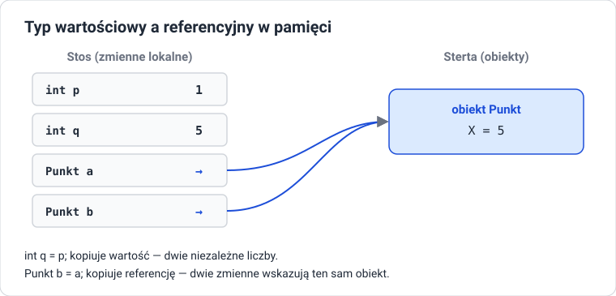

# Klasy i obiekty

!!! info "Cel lekcji"
    Po tej lekcji będziesz umieć zdefiniować klasę z polami i metodami, utworzyć obiekty i odwoływać się do ich składowych, wyjaśnić, czym jest referencja i co dzieje się przy przypisaniu oraz porównaniu obiektów, bezpiecznie obsłużyć wartość `null`, napisać konstruktory (także przeciążone i łańcuchowe), używać słowa `this` i nadpisać metodę `ToString`.

## Sprawdź intuicję

Nie uruchamiaj kodu. Zapisz przewidywany wynik każdej linii albo słowo „błąd”, a potem sprawdź.

??? question "Fragment 1: kopiowanie obiektu i liczby"
    ```csharp
    // Punkt.cs
    class Punkt { public int X; }

    // Program.cs
    Punkt a = new Punkt();
    a.X = 1;
    Punkt b = a;
    b.X = 5;

    int p = 1;
    int q = p;
    q = 5;

    Console.WriteLine(a.X);
    Console.WriteLine(p);
    ```

    Co wypiszą dwie ostatnie linie? Dlaczego `b = a` zachowuje się inaczej niż `q = p`? Ile obiektów `Punkt` powstało?

??? question "Fragment 2: publiczne dane"
    ```csharp
    // Konto.cs
    class Konto
    {
        public string Wlasciciel;
        public decimal Saldo;
    }

    // Program.cs
    Konto k = new Konto();
    k.Wlasciciel = "Ada";
    k.Saldo = 100;
    k.Saldo = -5000;
    k.Saldo = k.Saldo * 1000000;
    Console.WriteLine(k.Saldo);
    ```

    Czy kompilator zgłosi błąd? Co wypisze program? Czy to dobry model konta bankowego? Kto powinien pilnować reguł?

??? question "Fragment 3: wartości domyślne i null"
    ```csharp
    // Gracz.cs
    class Gracz
    {
        public string Imie;
        public int Punkty;
        public bool Aktywny;
    }

    // Program.cs
    Gracz g = new Gracz();
    Console.WriteLine(g.Punkty);
    Console.WriteLine(g.Aktywny);
    Console.WriteLine(g.Imie == null);
    Console.WriteLine(g.Imie.Length);
    ```

    Co wypisze każda linia? Czy któraś zgłosi błąd — przy kompilacji czy w trakcie działania? Skąd pola wzięły wartości?

## Anatomia klasy

```csharp
// Gracz.cs
class Gracz
{
    // pola: dane obiektu
    public string Imie = "";
    public int Punkty;

    // metody: działania obiektu
    public void DodajPunkty(int ile)
    {
        Punkty += ile;
    }

    public string Opis()
    {
        return $"{Imie}: {Punkty} pkt";
    }
}
```

- **pole** to zmienna należąca do obiektu; może mieć wartość początkową (`= ""`),
- **metoda** to działanie obiektu; ma dostęp do pól **tego** obiektu, na rzecz którego ją wywołano,
- nazwy klas, metod i publicznych składowych piszemy **PascalCase**,
- każdą klasę zapisujemy w **osobnym pliku** o tej samej nazwie: klasa `Gracz` → plik `Gracz.cs`; wszystkie pliki `.cs` w folderze projektu są kompilowane razem.

## Tworzenie i używanie obiektów

```csharp
// Program.cs
Gracz ada = new Gracz();       // deklaracja zmiennej typu Gracz i utworzenie obiektu
ada.Imie = "Ada";              // dostęp do pola przez kropkę
ada.Punkty = 10;
ada.DodajPunkty(5);            // wywołanie metody na obiekcie ada
Console.WriteLine(ada.Opis()); // Ada: 15 pkt
```

- `Gracz ada` — zmienna, która może wskazywać obiekt klasy `Gracz`,
- `new Gracz()` — tworzy nowy obiekt w pamięci i zwraca **referencję** do niego,
- kropka — dostęp do składowych obiektu.

### Inicjalizator obiektu

Pola publiczne można ustawić od razu przy tworzeniu:

```csharp
Gracz olek = new Gracz { Imie = "Olek", Punkty = 3 };
var ewa = new Gracz { Imie = "Ewa" };
Gracz kuba = new() { Imie = "Kuba" };     // typ znany z lewej strony
```

## Referencje



Klasy są **typami referencyjnymi**. Zmienna typu klasy nie zawiera obiektu — zawiera **referencję** (adres) do obiektu w pamięci.

| | Typ wartościowy (`int`, `double`, `bool`, `struct`) | Typ referencyjny (klasy, `string`, tablice) |
|---|---|---|
| zmienna zawiera | samą wartość | referencję do obiektu |
| przypisanie `b = a` | kopiuje wartość — dwie niezależne wartości | kopiuje referencję — **jeden obiekt, dwie zmienne** |
| `==` (domyślnie) | porównuje wartości | sprawdza, czy to **ten sam** obiekt |
| `null` | niedozwolone | „brak obiektu” |
| przekazanie do metody | metoda dostaje kopię wartości | metoda dostaje referencję i może zmienić obiekt |

### Porównywanie obiektów

```csharp
Gracz a = new Gracz { Imie = "Ada", Punkty = 10 };
Gracz b = new Gracz { Imie = "Ada", Punkty = 10 };
Gracz c = a;

Console.WriteLine(a == b);   // dwa różne obiekty o takich samych danych
Console.WriteLine(a == c);   // ta sama referencja
```

Dwa obiekty o identycznych polach to nadal **dwa różne obiekty**. Żeby porównywać dane, trzeba to zaprogramować — np. własną metodą `CzyTakiSam(Gracz inny)` albo nadpisaniem `Equals`.

### Obiekt jako argument metody

```csharp
static void Zeruj(Gracz g)
{
    g.Punkty = 0;                                    // zmienia obiekt, na który wskazuje g
    g = new Gracz { Imie = "Nowy", Punkty = 99 };    // zmienia tylko lokalną kopię referencji
}

Gracz a = new Gracz { Imie = "Ada", Punkty = 10 };
Zeruj(a);
Console.WriteLine($"{a.Imie} {a.Punkty}");
```

Metoda dostała **kopię referencji**. Przez nią może zmienić obiekt (pierwsza linia), ale przypisanie nowego obiektu do parametru nie zmienia zmiennej `a` poza metodą (druga linia).

## Wartości domyślne i null

Pola, którym nie nadano wartości, dostają **wartość domyślną** typu:

| Typ pola | Wartość domyślna |
|---|---|
| `int`, `long`, `double`, `decimal` | `0` |
| `bool` | `false` |
| `char` | znak o kodzie 0 |
| `string`, klasa, tablica, lista | `null` |

**`null`** oznacza: zmienna nie wskazuje żadnego obiektu. Odczyt pola lub wywołanie metody przez `null` powoduje wyjątek **`NullReferenceException`** w trakcie działania programu.

```csharp
Gracz g = null;

if (g != null)
{
    Console.WriteLine(g.Imie);
}

Console.WriteLine(g?.Imie);          // ?. — jeśli g to null, wynik też null (bez wyjątku)
Console.WriteLine(g?.Imie ?? "brak"); // ?? — wartość zastępcza
```

!!! tip "Unikaj null w polach"
    Najprostszy sposób: nadawaj polom typu `string` wartość początkową (`= ""`), a listom — nową, pustą listę (`= new List<string>()`). Przy włączonym `Nullable` kompilator ostrzega, gdy pole może pozostać `null`.

## Konstruktory

**Konstruktor** to specjalna metoda wywoływana **raz, przy `new`**. Jego zadanie: ustawić obiekt w poprawnym stanie początkowym.

```csharp
// Gracz.cs
class Gracz
{
    public string Imie;
    public int Punkty;

    public Gracz(string imie)
    {
        Imie = imie;
        Punkty = 0;
    }

    public Gracz(string imie, int punkty) : this(imie)   // najpierw wywołaj konstruktor (imie)
    {
        Punkty = punkty;
    }
}

// Program.cs
Gracz a = new Gracz("Ada");
Gracz b = new Gracz("Olek", 50);
```

Zasady:

- konstruktor ma **nazwę klasy** i **nie ma typu zwracanego** (nawet `void`),
- gdy nie napiszesz żadnego konstruktora, klasa ma **bezparametrowy konstruktor domyślny**,
- gdy napiszesz **własny** konstruktor, domyślny **znika** — `new Gracz()` przestanie się kompilować, chyba że dopiszesz `public Gracz() { }`,
- konstruktory można **przeciążać** (różne listy parametrów),
- `: this(...)` wywołuje inny konstruktor tej samej klasy — dzięki temu kod ustawiania pól nie jest powtarzany.

??? question "Czy to się skompiluje?"
    ```csharp
    // Gracz.cs
    class Gracz
    {
        public string Imie;
        public Gracz(string imie) { Imie = imie; }
    }

    // Program.cs
    Gracz a = new Gracz("Ola");
    Gracz b = new Gracz();
    Gracz c = new Gracz { Imie = "Ewa" };
    ```

    Która linia w `Program.cs` zgłosi błąd i dlaczego? Jak naprawić klasę, żeby wszystkie trzy linie działały?

## this — bieżący obiekt

`this` to referencja do obiektu, na rzecz którego wykonuje się metoda lub konstruktor.

```csharp
class Punkt
{
    private int x;
    private int y;

    public Punkt(int x, int y)
    {
        this.x = x;     // pole = parametr
        this.y = y;
    }

    public Punkt Przesun(int dx, int dy)
    {
        x += dx;
        y += dy;
        return this;    // zwracamy ten sam obiekt
    }

    public double Odleglosc(Punkt inny)
    {
        int dx = this.x - inny.x;
        int dy = this.y - inny.y;
        return Math.Sqrt(dx * dx + dy * dy);
    }
}

Punkt p = new Punkt(0, 0);
p.Przesun(1, 2).Przesun(3, 4);    // wywołania łańcuchowe
```

- w `this.x = x;` pole jest po lewej, parametr po prawej — `this` rozróżnia je, gdy mają tę samą nazwę,
- metoda wie, „czyje” dane zmienić, bo zawsze jest wywoływana na konkretnym obiekcie,
- zwracając `this`, pozwalamy łączyć wywołania.

## ToString — obiekt jako tekst

Każda klasa ma metodę `ToString()` odziedziczoną po klasie `object`. Domyślnie zwraca **nazwę typu**, co rzadko jest przydatne. Nadpisujemy ją słowem `override`:

```csharp
class Gracz
{
    public string Imie = "";
    public int Punkty;

    public override string ToString()
    {
        return $"{Imie}: {Punkty} pkt";
    }
}

Gracz g = new Gracz { Imie = "Ada", Punkty = 10 };
Console.WriteLine(g);              // wywołuje g.ToString()
Console.WriteLine($"Gracz {g}");   // interpolacja też wywołuje ToString()
```

Słowo `override` i klasę `object` omówimy dokładnie przy dziedziczeniu.

## Tablice i listy obiektów

```csharp
List<Gracz> gracze = new List<Gracz>
{
    new Gracz("Ada", 10),
    new Gracz("Olek", 3),
    new Gracz("Ewa", 7)
};

foreach (Gracz g in gracze)
{
    g.DodajPunkty(5);          // zmienia obiekty na liście — lista trzyma referencje
}

Gracz najlepszy = gracze[0];
foreach (Gracz g in gracze)
{
    if (g.Punkty > najlepszy.Punkty) najlepszy = g;
}
Console.WriteLine($"Prowadzi: {najlepszy}");
```

## Zadania

??? question "Zadanie 1: Prostokąt"
    Napisz klasę `Prostokat` z polami `Szerokosc` i `Wysokosc`, konstruktorem przyjmującym oba wymiary, metodami `Pole()`, `Obwod()`, `CzyKwadrat()` i nadpisanym `ToString()` (np. `Prostokąt 3 × 4`). Utwórz trzy prostokąty i wypisz informacje o każdym.

??? question "Zadanie 2: Referencje"
    Utwórz obiekt `Prostokat r1`, przypisz `r2 = r1`, zmień szerokość przez `r2` i wypisz `r1`. Następnie utwórz `r3` z takimi samymi wymiarami jak `r1` i sprawdź `r1 == r3`. Wyjaśnij oba wyniki i narysuj, co jest w pamięci.

??? question "Zadanie 3: Konstruktory łańcuchowe"
    Dodaj do klasy `Prostokat` konstruktor z jednym parametrem (kwadrat), który wywołuje konstruktor dwuparametrowy przez `: this(...)`, oraz konstruktor bezparametrowy tworzący prostokąt 1 × 1.

??? question "Zadanie 4: Uczeń"
    Napisz klasę `Uczen` z imieniem, nazwiskiem i listą ocen (`List<int>`, zainicjalizowaną w polu). Metody: `DodajOcene(int ocena)` (tylko 1–6), `Srednia()`, `CzyZagrozony()` (średnia poniżej 2), `ToString()`. W `Program.cs` utwórz listę trzech uczniów, dodaj oceny i wypisz ucznia z najwyższą średnią.

??? question "Zadanie 5: null"
    Napisz metodę `static string OpiszGracza(Gracz? g)`, która dla `null` zwraca „brak gracza”, a w przeciwnym razie wynik `ToString()`. Zapisz ją raz z `if`, raz z operatorami `?.` i `??`.

??? question "Zadanie 6: Punkt i odległość"
    Napisz klasę `Punkt` z konstruktorem, metodą `Przesun` zwracającą `this` i metodą `Odleglosc(Punkt inny)`. Wczytaj od użytkownika współrzędne trzech punktów i sprawdź, czy tworzą trójkąt prostokątny.
