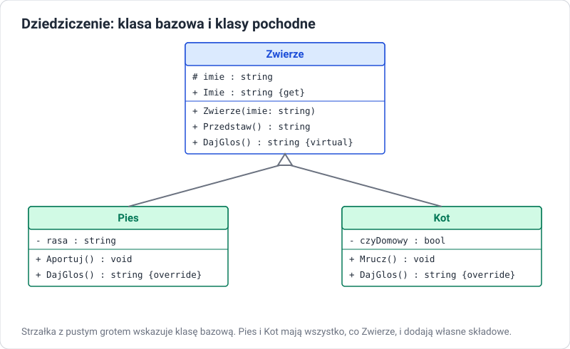

# Dziedziczenie

!!! info "Cel lekcji"
    Po tej lekcji będziesz umieć zdefiniować klasę bazową i klasy pochodne, wyjaśnić, co klasa pochodna dziedziczy, a czego nie, korzystać z modyfikatora `protected` i słowa `base`, wywoływać konstruktor klasy bazowej, blokować dziedziczenie słowem `sealed`, wyjaśnić rolę klasy `object` oraz ocenić, kiedy dziedziczenie jest właściwym rozwiązaniem.

## Problem: powtarzający się kod

```csharp
class Pies
{
    public string Imie = "";
    public int Wiek;
    public string Przedstaw() => $"{Imie}, {Wiek} lat";
    public void Aportuj() => Console.WriteLine($"{Imie} przynosi patyk");
}

class Kot
{
    public string Imie = "";
    public int Wiek;
    public string Przedstaw() => $"{Imie}, {Wiek} lat";
    public void Mrucz() => Console.WriteLine($"{Imie} mruczy");
}
```

`Imie`, `Wiek` i `Przedstaw` są zapisane dwa razy. Przy dziesięciu gatunkach — dziesięć razy. Zmiana formatu przedstawiania wymagałaby poprawki w każdej klasie.

## Rozwiązanie: klasa bazowa

Wspólne składowe przenosimy do **klasy bazowej**, a klasy szczegółowe **dziedziczą** po niej:

```csharp
// Zwierze.cs
class Zwierze
{
    public string Imie { get; }
    public int Wiek { get; protected set; }

    public Zwierze(string imie, int wiek)
    {
        Imie = imie;
        Wiek = wiek;
    }

    public string Przedstaw() => $"{Imie}, {Wiek} lat";
}

// Pies.cs
class Pies : Zwierze
{
    public string Rasa { get; }

    public Pies(string imie, int wiek, string rasa) : base(imie, wiek)
    {
        Rasa = rasa;
    }

    public void Aportuj() => Console.WriteLine($"{Imie} przynosi patyk");
}

// Kot.cs
class Kot : Zwierze
{
    public Kot(string imie, int wiek) : base(imie, wiek) { }

    public void Mrucz() => Console.WriteLine($"{Imie} mruczy");
}
```

```csharp
// Program.cs
Pies burek = new Pies("Burek", 3, "kundel");
Console.WriteLine(burek.Przedstaw());   // metoda odziedziczona po Zwierze
burek.Aportuj();                        // metoda własna klasy Pies

Kot filemon = new Kot("Filemon", 5);
filemon.Mrucz();
```



| Pojęcie | Inne nazwy | W przykładzie |
|---|---|---|
| **klasa bazowa** | nadklasa, klasa rodzica | `Zwierze` |
| **klasa pochodna** | podklasa, klasa potomna | `Pies`, `Kot` |
| **dziedziczyć** | rozszerzać, wywodzić się | `class Pies : Zwierze` |

## Relacja „jest”

Dziedziczenie wyraża relację **„jest rodzajem”** (*is-a*): pies **jest** zwierzęciem, kot **jest** zwierzęciem. Dlatego obiekt klasy pochodnej można przypisać do zmiennej typu bazowego:

```csharp
Zwierze z = new Pies("Burek", 3, "kundel");   // poprawne: pies jest zwierzęciem
Console.WriteLine(z.Przedstaw());              // dostępne: składowa Zwierze
// z.Aportuj();                                // błąd: przez zmienną typu Zwierze nie widać metod Psa

List<Zwierze> schronisko = new List<Zwierze>
{
    new Pies("Burek", 3, "kundel"),
    new Kot("Filemon", 5),
    new Pies("Azor", 7, "owczarek")
};
```

Odwrotnie nie wolno: nie każde zwierzę jest psem — `Pies p = new Zwierze(...)` się nie skompiluje.

!!! warning "Test „jest”"
    Zanim użyjesz dziedziczenia, powiedz zdanie „*Pochodna* jest rodzajem *Bazowej*”. „Samochód jest rodzajem pojazdu” — dobrze. „Samochód jest rodzajem silnika” — źle: samochód **ma** silnik. Relację „ma” (*has-a*) zapisujemy jako pole: `class Samochod { private Silnik silnik; }`. To **kompozycja**, i często jest lepszym wyborem niż dziedziczenie.

## Co klasa pochodna dziedziczy

| Składowa klasy bazowej | W klasie pochodnej |
|---|---|
| `public` pola, właściwości, metody | dostępne i widoczne na zewnątrz |
| `protected` składowe | dostępne w kodzie klasy pochodnej, niewidoczne na zewnątrz |
| `private` składowe | **istnieją** w obiekcie, ale kod klasy pochodnej nie ma do nich dostępu |
| konstruktory | **nie są dziedziczone** — klasa pochodna musi mieć własne |

### protected

```csharp
// Program.cs
// Program.cs
Pies p = new Pies("Burek");
// p.energia = 500;                   // błąd: protected nie jest dostępne z zewnątrz

// Zwierze.cs
class Zwierze
{
    protected int energia = 100;      // widoczne dla klas pochodnych

    public string Imie { get; }
    public Zwierze(string imie) { Imie = imie; }
}

// Pies.cs
class Pies : Zwierze
{
    public Pies(string imie) : base(imie) { }

    public void Biegaj()
    {
        energia -= 20;                // dostęp do pola protected
        Console.WriteLine($"{Imie} biega, energia: {energia}");
    }
}
```

`protected` używamy oszczędnie. Lepiej, żeby klasa bazowa udostępniała klasom pochodnym metody pilnujące reguł niż surowe pola.

## Konstruktory w hierarchii

Przy tworzeniu obiektu klasy pochodnej **najpierw** wykonuje się konstruktor klasy bazowej, a **potem** pochodnej. Konstruktor bazowy wskazujemy przez `: base(...)`:

```csharp
// Program.cs
Kierownik k = new Kierownik("Nowak", 9000, 5);
// konstruktor Pracownik
// konstruktor Kierownik

// Pracownik.cs
class Pracownik
{
    public string Nazwisko { get; }
    public decimal Pensja { get; protected set; }

    public Pracownik(string nazwisko, decimal pensja)
    {
        Nazwisko = nazwisko;
        Pensja = pensja;
        Console.WriteLine("konstruktor Pracownik");
    }
}

// Kierownik.cs
class Kierownik : Pracownik
{
    public int LiczbaPodwladnych { get; }

    public Kierownik(string nazwisko, decimal pensja, int podwladni) : base(nazwisko, pensja)
    {
        LiczbaPodwladnych = podwladni;
        Console.WriteLine("konstruktor Kierownik");
    }
}
```

Jeśli klasa bazowa **nie ma** konstruktora bezparametrowego, klasa pochodna **musi** wywołać `base(...)` z argumentami — inaczej błąd kompilacji `CS7036`.

## base — dostęp do wersji z klasy bazowej

Słowo `base` pozwala wywołać metodę klasy bazowej z wnętrza klasy pochodnej — np. żeby rozszerzyć jej działanie zamiast pisać od nowa:

```csharp
class Zwierze
{
    public string Imie { get; }
    public Zwierze(string imie) { Imie = imie; }

    public virtual string Opis() => $"Zwierzę: {Imie}";
}

class Pies : Zwierze
{
    public string Rasa { get; }
    public Pies(string imie, string rasa) : base(imie) { Rasa = rasa; }

    public override string Opis() => base.Opis() + $", rasa: {Rasa}";
}
```

Słowa `virtual` i `override` omawiamy dokładnie w lekcji o polimorfizmie.

## Hierarchia wielopoziomowa

Klasa pochodna może być bazową dla kolejnej:

```csharp
class Pojazd { }
class PojazdSilnikowy : Pojazd { }
class Samochod : PojazdSilnikowy { }
class SamochodElektryczny : Samochod { }
```

`SamochodElektryczny` ma wszystko, co trzy klasy nad nim. Hierarchie głębsze niż 3–4 poziomy są trudne w utrzymaniu — zmiana na górze wpływa na wszystkie klasy poniżej.

## Jedna klasa bazowa

W C# klasa może dziedziczyć **tylko po jednej** klasie bazowej (dziedziczenie **jednokrotne**). Zapis `class C : A, B` dla dwóch klas jest błędem. Gdy obiekt ma mieć kilka zestawów zachowań, używamy **interfejsów** — klasa może implementować ich dowolnie wiele. To odpowiednik dziedziczenia wielokrotnego znanego z C++.

## sealed — zakaz dziedziczenia

```csharp
sealed class Haslo
{
    // nikt nie może utworzyć klasy pochodnej i zmienić zachowania
}

// class MojeHaslo : Haslo { }   // błąd CS0509
```

Klasa `string` w .NET jest `sealed`.

## Klasa object — wspólny przodek

Każda klasa w C#, nawet bez dwukropka, dziedziczy po klasie **`object`** (`System.Object`). Dlatego każdy obiekt ma metody:

| Metoda | Działanie domyślne |
|---|---|
| `ToString()` | zwraca nazwę typu |
| `Equals(object)` | sprawdza, czy to ten sam obiekt (dla klas) |
| `GetHashCode()` | liczba używana przez słowniki i zbiory |
| `GetType()` | informacja o rzeczywistym typie obiektu |

Nadpisując `ToString()` słowem `override`, zastępujemy wersję odziedziczoną po `object`.

## Kiedy dziedziczyć, a kiedy nie

| Dziedzicz, gdy… | Nie dziedzicz, gdy… |
|---|---|
| zachodzi relacja „jest rodzajem” | zachodzi relacja „ma” — użyj pola (kompozycji) |
| klasy pochodne naprawdę współdzielą dane i zachowanie | chcesz tylko skorzystać z kilku metod innej klasy |
| obiekt pochodny może zastąpić bazowy w każdym miejscu programu | klasa pochodna musiałaby „wyłączać” część zachowania bazowej |

Klasyczny przykład błędu: `class Kwadrat : Prostokat`. Kwadrat jest prostokątem w matematyce, ale jeśli `Prostokat` pozwala zmieniać szerokość niezależnie od wysokości, `Kwadrat` musiałby to łamać — i kod działający dla prostokątów przestałby działać dla kwadratów.

## Zadania

??? question "Zadanie 1: Pojazdy"
    Zaprojektuj (diagram UML) i napisz klasę bazową `Pojazd` (marka, rok produkcji, przebieg z `protected set`, metoda `Jedz(int km)` zwiększająca przebieg) oraz klasy pochodne `Samochod` (liczba drzwi) i `Rower` (liczba przerzutek). Każda klasa ma konstruktor wywołujący konstruktor bazowy i nadpisany `ToString()`.

??? question "Zadanie 2: Kolejność konstruktorów"
    Dodaj do konstruktorów klas z zadania 1 wypisywanie komunikatu i dodaj trzeci poziom: `SamochodElektryczny : Samochod` (pojemność baterii). Utwórz obiekt najniższej klasy i zapisz kolejność komunikatów. Wyjaśnij ją.

??? question "Zadanie 3: Pracownicy"
    Klasa `Pracownik` (imię, nazwisko, pensja podstawowa, metoda `Wyplata()` zwracająca pensję) i pochodne: `Kierownik` (dodatek funkcyjny), `Handlowiec` (prowizja 5% od sprzedaży, metoda `DodajSprzedaz(decimal kwota)`). Na razie `Wyplata()` liczy tylko pensję podstawową — w lekcji o polimorfizmie każda klasa policzy ją po swojemu. Utwórz listę `List<Pracownik>` z obiektami wszystkich klas i wypisz ich nazwiska.

??? question "Zadanie 4: Jest czy ma?"
    Dla każdej pary zdecyduj: dziedziczenie czy pole (kompozycja)? Uzasadnij. Uczeń — Osoba; Samochód — Koło; Prostokąt — Figura; Biblioteka — Książka; Admin — Użytkownik; Telefon — Bateria.

??? question "Zadanie 5: Znajdź błędy"
    ```csharp
    class Osoba
    {
        private string imie;
        public Osoba(string imie) { this.imie = imie; }
    }

    class Uczen : Osoba
    {
        public string Klasa;
        public Uczen(string klasa) { Klasa = klasa; }
        public string Opis() => $"{imie} z klasy {Klasa}";
    }
    ```

    Wskaż oba błędy kompilacji, wyjaśnij przyczyny i popraw kod.
