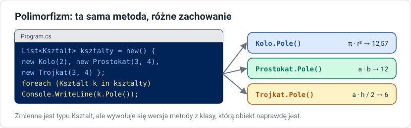

# Polimorfizm

!!! info "Cel lekcji"
    Po tej lekcji będziesz umieć wyjaśnić, czym jest polimorfizm, deklarować metody wirtualne i nadpisywać je w klasach pochodnych, tworzyć klasy i metody abstrakcyjne, przetwarzać kolekcję obiektów różnych klas przez wspólny typ bazowy, bezpiecznie sprawdzać i zmieniać typ obiektu (`is`, `as`, wzorce) oraz odróżnić nadpisywanie (`override`) od ukrywania (`new`).

## Na czym polega polimorfizm

**Polimorfizm** (wielopostaciowość) oznacza, że **to samo wywołanie** metody na zmiennej typu bazowego **działa różnie** — zależnie od tego, jakiej klasy jest naprawdę obiekt.



```csharp
List<Ksztalt> ksztalty = new()
{
    new Kolo(2),
    new Prostokat(3, 4),
    new Trojkat(3, 4)
};

foreach (Ksztalt k in ksztalty)
{
    Console.WriteLine($"{k.Nazwa}: pole {k.Pole():F2}");
}
```

Pętla nie wie, czy ma do czynienia z kołem, czy z prostokątem. Wywołuje `k.Pole()`, a środowisko uruchomieniowe wybiera wersję metody z **rzeczywistej klasy** obiektu. Dodanie nowej figury nie wymaga zmiany tej pętli.

## virtual i override

Metoda, którą klasy pochodne mogą zastąpić własną wersją, musi być w klasie bazowej oznaczona **`virtual`**. Klasa pochodna zastępuje ją słowem **`override`**.

```csharp
// Zwierze.cs
class Zwierze
{
    public string Imie { get; }
    public Zwierze(string imie) { Imie = imie; }

    public virtual string DajGlos() => "...";           // wersja domyślna
}

// Pies.cs
class Pies : Zwierze
{
    public Pies(string imie) : base(imie) { }
    public override string DajGlos() => "Hau!";
}

// Kot.cs
class Kot : Zwierze
{
    public Kot(string imie) : base(imie) { }
    public override string DajGlos() => "Miau!";
}

// Ryba.cs
class Ryba : Zwierze
{
    public Ryba(string imie) : base(imie) { }
    // brak override — używa wersji z klasy Zwierze
}
```

```csharp
// Program.cs
Zwierze[] zwierzeta = { new Pies("Burek"), new Kot("Filemon"), new Ryba("Nemo") };
foreach (Zwierze z in zwierzeta)
{
    Console.WriteLine($"{z.Imie}: {z.DajGlos()}");
}
// Burek: Hau!
// Filemon: Miau!
// Nemo: ...
```

Zasady:

- `override` może zastąpić tylko metodę oznaczoną w klasie bazowej `virtual`, `abstract` albo `override`,
- sygnatura i typ zwracany muszą się zgadzać,
- modyfikator dostępu musi być taki sam,
- w wersji nadpisanej można wywołać wersję bazową przez `base.DajGlos()`,
- dotyczy to także właściwości: `public virtual string Opis => ...`.

### Typ zmiennej a typ obiektu

```csharp
Zwierze z = new Pies("Burek");
```

| | Co decyduje | W przykładzie |
|---|---|---|
| **które składowe są dostępne** w kodzie | typ **zmiennej** (sprawdza kompilator) | tylko składowe `Zwierze` |
| **która wersja metody wirtualnej się wykona** | typ **obiektu** (sprawdza środowisko podczas działania) | `Pies.DajGlos()` |

To jest sedno polimorfizmu: kompilator pilnuje, że metoda istnieje, a wybór konkretnej wersji następuje dopiero w trakcie działania programu (**późne wiązanie**).

## Klasy i metody abstrakcyjne

Co powinno zwracać `Pole()` w klasie `Ksztalt`? Nie ma sensownej odpowiedzi — „kształt w ogóle” nie ma pola. Taką metodę deklarujemy jako **abstrakcyjną**: bez ciała, z obowiązkiem implementacji w klasach pochodnych.

```csharp
// Ksztalt.cs
abstract class Ksztalt
{
    public abstract string Nazwa { get; }
    public abstract double Pole();
    public abstract double Obwod();

    public override string ToString() => $"{Nazwa}: pole {Pole():F2}, obwód {Obwod():F2}";
}

// Kolo.cs
class Kolo : Ksztalt
{
    public double Promien { get; }
    public Kolo(double promien) { Promien = promien; }

    public override string Nazwa => "koło";
    public override double Pole() => Math.PI * Promien * Promien;
    public override double Obwod() => 2 * Math.PI * Promien;
}

// Prostokat.cs
class Prostokat : Ksztalt
{
    public double A { get; }
    public double B { get; }
    public Prostokat(double a, double b) { A = a; B = b; }

    public override string Nazwa => "prostokąt";
    public override double Pole() => A * B;
    public override double Obwod() => 2 * (A + B);
}
```

| | Klasa abstrakcyjna | Zwykła klasa |
|---|---|---|
| słowo kluczowe | `abstract class` | `class` |
| tworzenie obiektu `new` | **niemożliwe** | możliwe |
| metody abstrakcyjne (bez ciała) | może mieć | nie może mieć |
| zwykłe metody, pola, konstruktory | może mieć | może mieć |
| cel | wspólna baza i **kontrakt** dla klas pochodnych | konkretny model |

- `new Ksztalt()` to błąd kompilacji — klasa abstrakcyjna jest niepełna,
- klasa pochodna **musi** zaimplementować wszystkie metody abstrakcyjne (albo sama być abstrakcyjna),
- metoda abstrakcyjna jest automatycznie wirtualna.

Zwróć uwagę na `ToString()` w klasie `Ksztalt`: jest napisana raz, a korzysta z `Pole()` i `Obwod()`, które każda figura liczy po swojemu.

## Sprawdzanie typu: is, as, wzorce

Czasem trzeba wiedzieć, jakiej klasy jest obiekt, np. żeby wywołać metodę dostępną tylko w klasie pochodnej (tu: `Aportuj` i `Rasa` z klasy `Pies` z poprzedniej lekcji).

```csharp
foreach (Zwierze z in zwierzeta)
{
    if (z is Pies p)              // czy z jest Psem? jeśli tak — zmienna p typu Pies
    {
        p.Aportuj();
    }
}

Pies? pies = z as Pies;           // as: rzutowanie albo null, gdy się nie da
if (pies != null) pies.Aportuj();

Pies pewny = (Pies)z;             // rzutowanie jawne: wyjątek InvalidCastException, gdy z nie jest Psem

string opis = z switch
{
    Pies p => $"pies rasy {p.Rasa}",
    Kot => "kot",
    _ => "inne zwierzę"
};
```

!!! tip "Polimorfizm zamiast sprawdzania typów"
    Jeśli w kodzie pojawia się dużo `if (x is Pies) … else if (x is Kot) …`, zwykle lepiej dodać metodę wirtualną do klasy bazowej i nadpisać ją w klasach pochodnych. Wtedy nowa klasa nie wymaga szukania i poprawiania wszystkich takich warunków.

## override a new

Metodę o tej samej sygnaturze można też **ukryć** słowem `new`. Wtedy wybór wersji zależy od typu **zmiennej**, a nie obiektu — polimorfizm nie działa.

```csharp
class A
{
    public virtual string Wirtualna() => "A";
    public string Zwykla() => "A";
}

class B : A
{
    public override string Wirtualna() => "B";
    public new string Zwykla() => "B";
}

A x = new B();
Console.WriteLine(x.Wirtualna());   // B — decyduje typ obiektu
Console.WriteLine(x.Zwykla());      // A — decyduje typ zmiennej
```

`new` przy metodzie stosuje się rzadko, zwykle gdy nie możemy zmienić klasy bazowej. Jeśli w klasie pochodnej napiszesz metodę o tej samej nazwie bez `override` i bez `new`, kompilator ostrzeże (`CS0108`) — najczęściej oznacza to zapomniane `virtual` / `override`.

## sealed override

Metodę nadpisaną można zablokować przed dalszym nadpisywaniem:

```csharp
class Kierownik : Pracownik
{
    public sealed override decimal Wyplata() => Pensja + Dodatek;
}
```

## Polimorfizm w bibliotece .NET

- `Console.WriteLine(obiekt)` wywołuje `obiekt.ToString()` — działa dla każdej klasy dzięki temu, że `ToString` jest wirtualna w `object`,
- `List<T>.Contains` korzysta z wirtualnej metody `Equals`,
- wszystkie wyjątki dziedziczą po `Exception` i można je obsłużyć jednym `catch (Exception)`.

## Zadania

??? question "Zadanie 1: Figury"
    Dokończ hierarchię kształtów: dodaj `Trojkat` (trzy boki, pole ze wzoru Herona) i `Kwadrat`. Utwórz listę 6 figur różnych rodzajów, wypisz je, policz sumę pól i znajdź figurę o największym obwodzie — bez sprawdzania typów obiektów.

??? question "Zadanie 2: Wypłaty"
    Rozbuduj hierarchię pracowników z lekcji o dziedziczeniu: `Wyplata()` jest wirtualna, `Kierownik` dolicza dodatek funkcyjny, `Handlowiec` — prowizję od sprzedaży, a nowa klasa `Stazysta` dostaje 60% pensji podstawowej. Wypisz listę płac i sumę wypłat.

??? question "Zadanie 3: Abstrakcyjny pracownik"
    Zmień klasę `Pracownik` na abstrakcyjną z abstrakcyjną metodą `Wyplata()`. Co musisz zmienić w klasach pochodnych? Czy można teraz utworzyć obiekt `new Pracownik(...)`? Dlaczego to dobra decyzja projektowa?

??? question "Zadanie 4: Przewiduj"
    Przewidź, a potem sprawdź wyniki. Wyjaśnij każdy.

    ```csharp
    class Bazowa
    {
        public virtual string Kto() => "bazowa";
        public string Przedstaw() => $"Jestem {Kto()}";
    }
    class Pochodna : Bazowa
    {
        public override string Kto() => "pochodna";
    }

    Bazowa b = new Pochodna();
    Console.WriteLine(b.Kto());
    Console.WriteLine(b.Przedstaw());
    Console.WriteLine(new Bazowa().Przedstaw());
    ```

??? question "Zadanie 5: Zoo"
    Abstrakcyjna klasa `Zwierze` z abstrakcyjnymi metodami `DajGlos()` i `Jedz()` oraz zwykłą `Przedstaw()`. Co najmniej cztery gatunki. Program symuluje dzień w zoo: karmienie wszystkich zwierząt, odgłosy, a na koniec osobna akcja tylko dla psów (wykryta wzorcem `is`). Zastanów się, czy tę ostatnią akcję da się zapisać bez sprawdzania typu.

??? question "Zadanie 6: Mini-projekt — gra tekstowa"
    Abstrakcyjna klasa `Postac` (imię, punkty życia, metoda `Atakuj(Postac cel)` i abstrakcyjna `ObliczObrazenia()`), klasy `Wojownik`, `Mag`, `Lucznik` z różnym sposobem liczenia obrażeń (np. mag ma szansę na podwójne obrażenia). Program symuluje pojedynek dwóch losowych postaci, tura po turze, aż jedna przegra.
